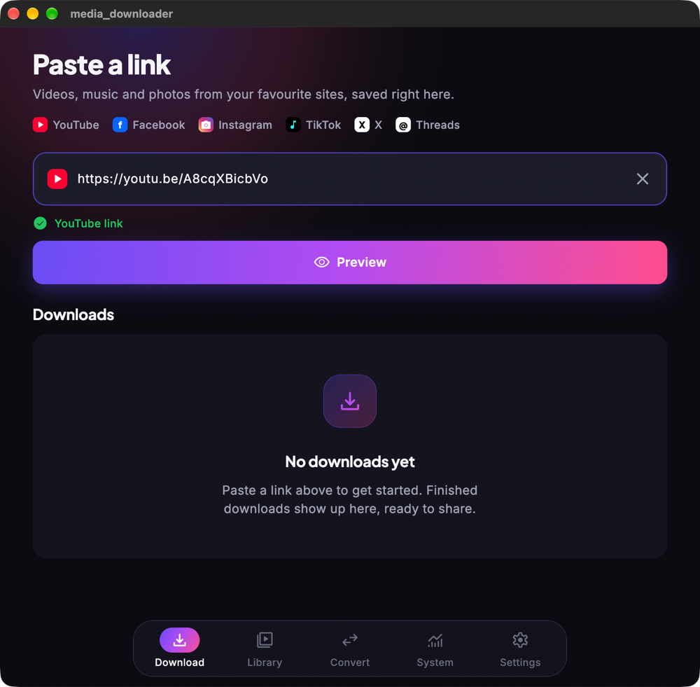
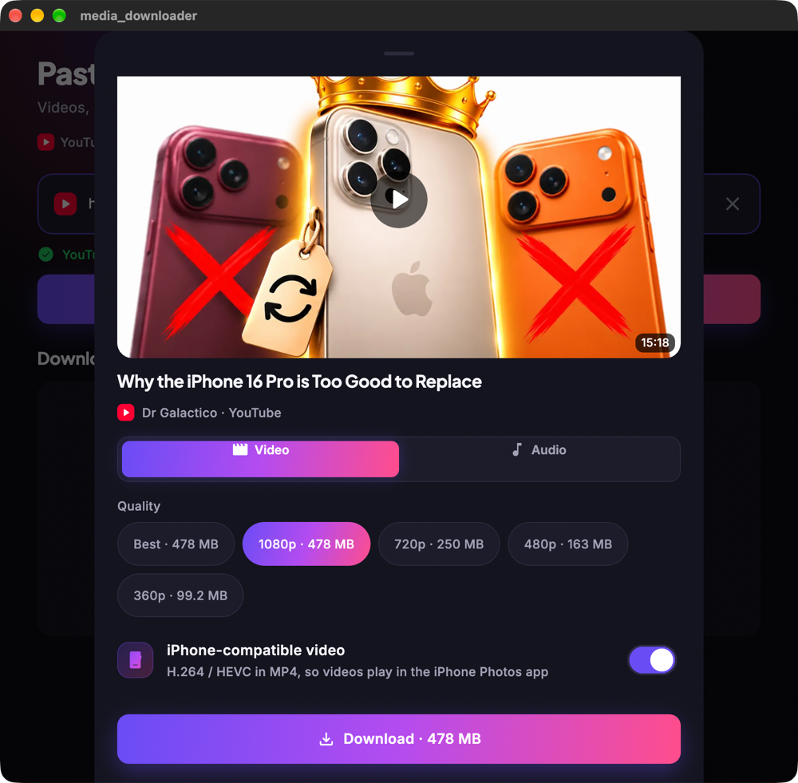
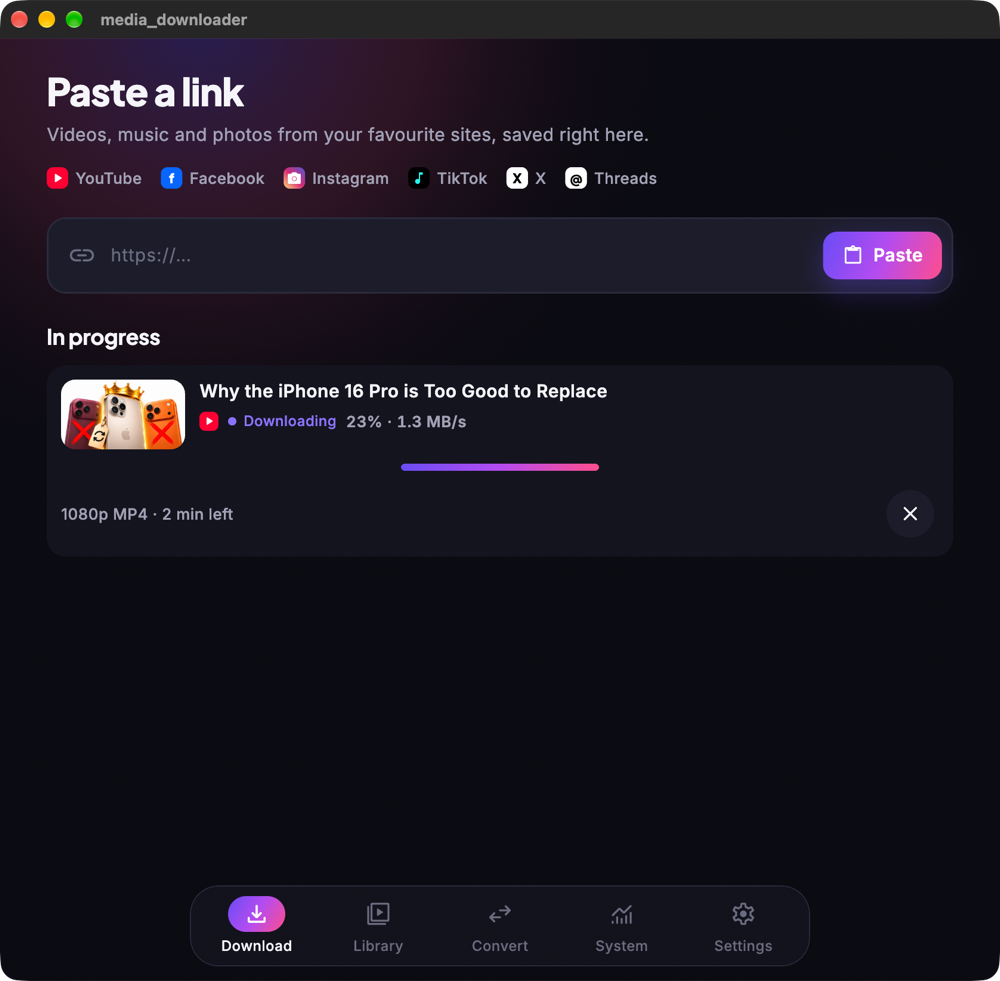
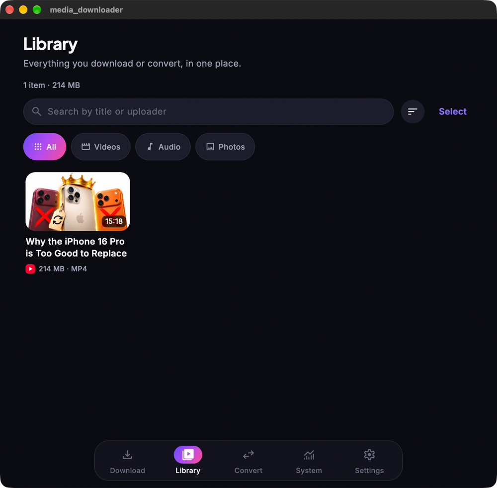
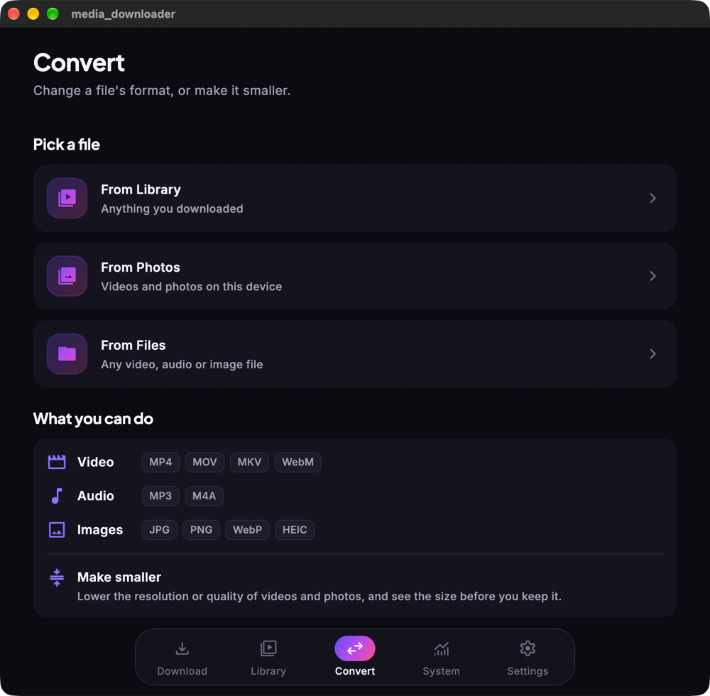
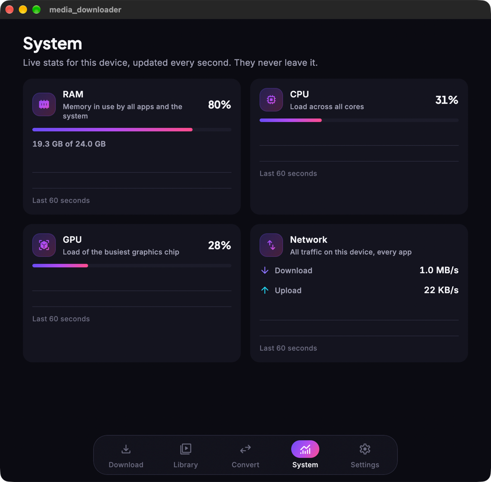
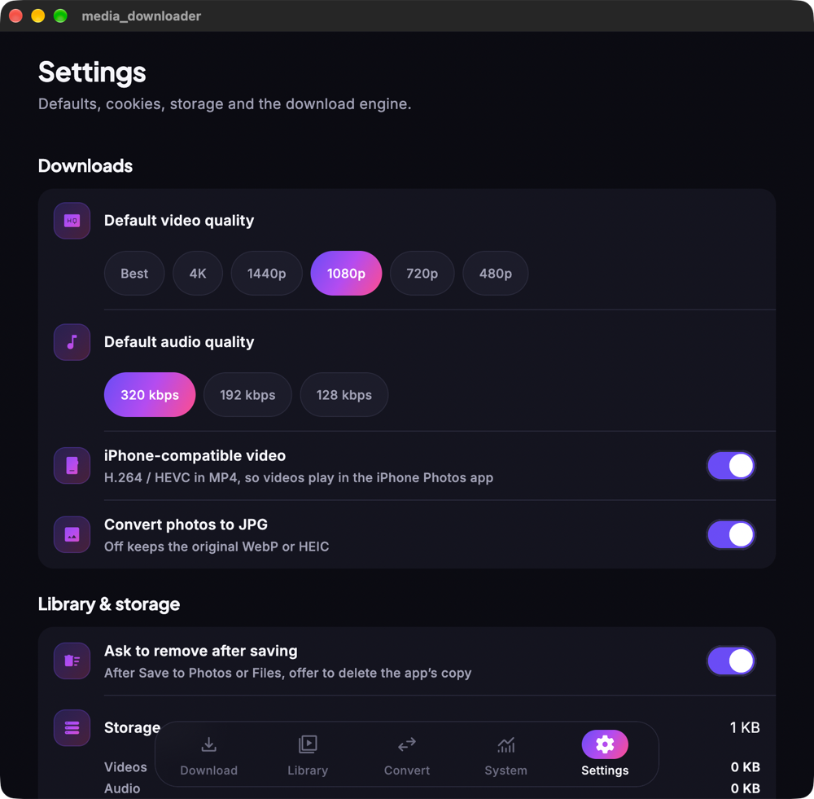

# Media Tool

**Paste a link, pick a quality, and keep the video, audio or photos.** Media Tool is a Flutter app for **Android, iOS, macOS, Windows and Linux**. It downloads from YouTube, Facebook, Instagram, Threads, X/Twitter and TikTok, keeps everything in its own Library, and converts or compresses media files. It also shows live device stats.

Everything runs **on your device**. There is no server, account, analytics or crash reporting. Your cookies, history and errors never leave the device.

> **Personal-use tool.** It isn't published to any app store. Ready-to-install builds are on GitHub Releases. You're responsible for having the rights to anything you download. The app shows this notice once on first launch.

## ⬇️ Download the app

Get the latest version from the **[Releases page](https://github.com/gaurishankar007/Flutter-Media-Tool/releases)** (pre-releases like `1.0.0-beta.1` are listed there too). No developer tools needed.

| Platform | File | How to install |
|---|---|---|
| **Android** | `MediaTool-<version>-android.apk` (one file for every phone, tablet, emulator and Chromebook) | Open the APK on your phone and allow *Install unknown apps* when asked. Updates install over the old version. |
| **macOS** | `MediaTool-<version>-macos.dmg` (Apple silicon and Intel) | Open the DMG and drag **Media Tool** to **Applications**. The app isn't notarized, so on first launch macOS blocks it. Click **Done**, then go to **System Settings → Privacy & Security → Open Anyway**. |
| **Windows** | `MediaTool-<version>-windows-x64.zip` (64-bit Intel/AMD) | Extract the zip anywhere (for example your user folder) and run `Media Tool\media_tool.exe`. The app isn't signed, so SmartScreen may warn on first launch: click **More info → Run anyway**. Keep the folder together; the app needs the `data` and `bin` folders next to it. |
| **Linux** | `MediaTool-<version>-linux-x64.tar.gz` (64-bit Intel/AMD, GTK 3) | `tar -xzf MediaTool-<version>-linux-x64.tar.gz`, then run `MediaTool/media_tool`. Save to Files needs a file dialog (the desktop portal, `zenity` or `kdialog`). Videos can't be played inside the app on Linux. |
| **iPhone** | Not available as a download | Apple only allows installs from the App Store or a developer's Mac, so install it from source with your own Apple ID (see [Install on an iPhone](#install-on-an-iphone)). |

> **Status:** all v1 features are implemented and compile on every platform. Windows and Linux are new and built only in CI so far; on-device testing is in progress, so expect rough edges, especially with site extractors, which break whenever a site changes its pages.

## Screenshots

<table>
  <tr>
    <td align="center"><br><sub><b>Paste a link</b></sub></td>
    <td align="center"><br><sub><b>Preview and pick a quality</b></sub></td>
    <td align="center"><br><sub><b>Download progress</b></sub></td>
  </tr>
  <tr>
    <td align="center"><br><sub><b>Library</b></sub></td>
    <td align="center"><br><sub><b>Convert and compress</b></sub></td>
    <td align="center"><br><sub><b>System stats</b></sub></td>
  </tr>
  <tr>
    <td align="center"><br><sub><b>Settings</b></sub></td>
    <td></td>
    <td></td>
  </tr>
</table>

<sub>Screenshots from the macOS app. Android and iOS use the same design with a bottom bar.</sub>

---

## Contents

- [Screenshots](#screenshots)
- [What you can do](#what-you-can-do)
- [Supported sites](#supported-sites)
- [The five tabs](#the-five-tabs)
- [How to use it](#how-to-use-it)
- [Getting started](#getting-started)
- [How it works](#how-it-works)
- [Privacy](#privacy)
- [Project structure](#project-structure)
- [Documentation](#documentation)
- [Troubleshooting](#troubleshooting)

---

## What you can do

| You want to… | The app does |
|---|---|
| Save a video | MP4 from Best / 4K / 1440p / 1080p / 720p / 480p, with a size estimate for each |
| Save just the audio | MP3 at 320 / 192 / 128 kbps |
| Save photos from a post | JPG photos from Instagram carousels, TikTok photo slideshows, Facebook photo posts and albums, Threads and X. Choose which photos to keep. |
| Turn a TikTok slideshow into a video | "Save as video" builds an MP4 from the slides and their music |
| Watch before downloading | Preview the thumbnail, title, uploader and duration, and play the video in the app before downloading |
| Play the files on an iPhone | iPhone-compatible output (HEVC or H.264 + AAC in MP4) is on by default |
| Keep downloading in the background | Android runs downloads in a foreground service with a progress notification and a Cancel button |
| Manage your downloads | Use the **Library**: search, filter, sort, view or play, then Save to Photos, Save to Files, Share or Delete |
| Convert a file | Video ↔ MP4 / MKV / WebM / MOV, video → MP3 / M4A, image ↔ JPG / PNG / WebP / HEIC |
| Shrink a file | Video: quality presets, a max resolution or "aim for about N MB". Image: resize, set quality, strip metadata |
| Download private or login-only posts | Import a `cookies.txt` for that site. It's used only for that site. |
| Keep it working when sites change | One-tap yt-dlp engine update, plus a daily check for new versions |
| Watch your device | The **System** tab shows live network speed, battery, RAM, CPU, GPU and storage, including how much space Media Tool's files take (whatever the platform supports) |

## Supported sites

| Site | Video / audio | Photos |
|---|---|---|
| YouTube | ✅ videos and Shorts, up to 4K, plus MP3 | n/a |
| Facebook | ✅ videos and Reels | ✅ photo posts and albums |
| Instagram | ✅ posts and Reels (Stories need cookies) | ✅ photos and carousels |
| X / Twitter | ✅ videos | ✅ images |
| TikTok | ✅ videos and short links | ✅ photo posts (slideshows) |
| Threads | ✅ | ✅ |

Paste any link and the app works out whether it's a video post or a photo post. Mixed posts (video and photos) let you choose between Video, Audio and Photos. Short links are followed automatically.

Private posts, or posts that need you to be logged in, need that site's cookies (see [Settings](#settings)).

## The five tabs

The bottom bar shows on phones and a sidebar shows on tablets and desktops.

### ⬇️ Download
- Paste a link, or use the paste button. The app recognises the site and shows a preview.
- Choose **Video**, **Audio** or **Photos**, then a quality. The defaults come from Settings.
- Downloads go into a queue that runs up to two at a time. Each one shows progress, speed and ETA, with Cancel and Try again.
- Each stage is shown: downloading, merging, extracting audio, converting for iPhone, and saving.
- Finished downloads get **Share** and **Remove**. Tap one to open it in the viewer.
- When a download fails, it suggests a fix: **Update engine** if the site changed, or **Cookies** if the post needs a login.

### 📚 Library
- Everything you download or convert is saved in the **app's own folder** first, not straight to your gallery.
- A grid of thumbnails. You can filter by Videos, Audio or Photos and by site, sort by newest, oldest or largest, and search by title.
- A post's photos are grouped into one card.
- A full-screen viewer lets you swipe between items. It plays video and audio, and you can zoom into photos.
- Actions for each item, or for several selected at once:
  - **Save to Photos** (gallery)
  - **Save to Files** (a folder or the Files app)
  - **Share**
  - **Delete**
  - **Convert**
- After a save works, the app asks *"Remove it from the app to free up space?"* You can tick "don't ask again". Saved items show a ✓.

### 🔄 Convert
1. Pick a file from the **Library**, **Photos** or **Files**.
2. Choose **Convert** (new format) or **Compress** (smaller file).
3. Set the options and tap **Convert**. The button stays at the bottom of the screen.
4. See the size before and after, and a preview. Then Save to Photos or Files, Share, or Done. The result is also added to the Library.

| Convert | Formats |
|---|---|
| Video → video | MP4, MKV, WebM, MOV (an iPhone-compatible option is available) |
| Video → audio | MP3, M4A |
| Image → image | JPG, PNG, WebP, HEIC (HEIC is hidden on Android, Windows and Linux, and WebP on macOS, where they aren't reliable) |

| Compress | Options |
|---|---|
| Video | Quality preset, max resolution (1080p / 720p / 480p), "aim for about N MB" |
| Image | Longest side or %, quality, strip metadata |

### 📊 System
Live device stats. Network, RAM, CPU and GPU update every second with a 60-second graph; battery and storage update every few seconds. Cards also show hardware details. It only shows what your platform can measure. There are no "not available" placeholders.

| Platform | Network ↓ / ↑ | Battery | RAM | CPU | GPU | Storage |
|---|---|---|---|---|---|---|
| Android | ✅ whole device | ✅ level, status, temperature, health, cycles (Android 14+), charge left in mAh (if the phone reports them) | ✅ | chip, cores, layout, max clock (no live load) | — | ✅ |
| iOS | ✅ whole device | ✅ level and status | ✅ | ✅ load, chip, cores, layout | GPU name (no live load) | ✅ |
| macOS | ✅ whole device | ✅ laptops: level, status, time left, health %, cycles, design / full / remaining mAh | ✅ type, manufacturer | ✅ load, chip, cores, threads, layout | ✅ load, name, GPU cores | ✅ drive model, NVMe / SSD, interface |
| Windows | ✅ physical adapters | ✅ level, status, time left | ✅ type, manufacturer, speed | ✅ load, chip, cores, threads, max clock | GPU name (no live load) | ✅ drive model, NVMe / SSD, interface |
| Linux | ✅ physical adapters | ✅ level, status, health %, cycles, design / full / remaining mAh | ✅ | ✅ load, chip, cores, threads, max clock | name; load on AMD (and some Intel) | ✅ drive model, NVMe / SSD, interface |

**Storage** shows used, free and total space, plus how much Media Tool's own files take. **RAM** and **Storage** have a **Test speed** button that measures real read and write speed (and RAM copy speed) in a few seconds; the storage test writes a temporary file and deletes it. It polls only while the tab is on screen.

### ⚙️ Settings
- **Downloads:** default video and audio quality, the iPhone-compatible output toggle, and "convert photos to JPG".
- **Library and storage:** "ask to remove after saving", storage used by Videos, Audio and Photos, and **Clear saved items**.
- **Cookies:** import a `cookies.txt` for each site, with step-by-step help. See which sites have cookies, and replace or remove them. On desktops you can also use a browser's cookies directly (macOS: Safari, Chrome, Firefox; Linux: Chrome, Firefox; Windows: Firefox).
- **Engine:** the yt-dlp version, **Update**, and the daily check when the app opens. A dot on the Settings tab means an update is available.
- **Appearance:** light, dark or follow the system.
- **About:** app and engine versions, licences, the rights notice, and **Copy error log** (to your clipboard only).
- **Developer** (debug builds only): a **Design Gallery** with every UI component and toast.

## How to use it

1. **Download a video:** open a post in the YouTube, Instagram, TikTok or X app → **Share → Copy link** → open Media Tool → tap **Paste** → **Preview** → pick **Video** and **1080p** → **Download**.
2. **Get the MP3:** do the same, but choose **Audio** and **320 kbps**.
3. **Save carousel photos:** paste an Instagram, TikTok, Facebook, Threads or X photo post → **Photos** → untick the ones you don't want → **Download N photos**.
4. **Move it to your gallery:** **Library** → long-press the item → **Save to Photos** → choose whether to remove it from the app.
5. **Make a video smaller to send:** **Convert** → **From Library** → **Compress** → "aim for about 25 MB" → **Convert** → **Share**.
6. **Download a private post:** export cookies from a browser where you're logged in to that site (Settings → Cookies shows how) → import them for that site → paste the link again.
7. **When a site stops working:** **Settings → Engine → Update**, or tap **Update engine** on the failed download.

## Getting started

### Requirements
- Flutter **3.50.1** / Dart **3.14** or newer
- **Android:** Android SDK (compileSdk 37), a phone with USB debugging, or an emulator. Min Android 7.0 (API 24).
- **iOS / macOS:** Xcode and CocoaPods. For an iPhone you also need an Apple ID or developer team to sign with.
- **Windows:** Visual Studio 2022 with the *Desktop development with C++* workload. x64 only.
- **Linux:** `clang cmake ninja-build pkg-config libgtk-3-dev liblzma-dev libstdc++-12-dev` (Ubuntu package names). x64 is what releases build; ARM64 works from source.

### Clone and set up
```bash
git clone https://github.com/gaurishankar007/Flutter-Media-Tool.git
cd Flutter-Media-Tool
flutter pub get

# The engine binaries are not in git. Fetch them once per machine:
macos/scripts/fetch_engine_binaries.sh   # macOS: yt-dlp_macos + ffmpeg/ffprobe (add --with-deno to bundle deno)
ios/scripts/fetch_engine.sh              # iOS: embedded Python + yt-dlp + FFmpegKit frameworks
linux/scripts/fetch_engine_binaries.sh   # Linux: yt-dlp_linux + ffmpeg/ffprobe (add --with-deno)
# Windows (PowerShell): yt-dlp.exe + ffmpeg.exe/ffprobe.exe (add -WithDeno)
powershell -ExecutionPolicy Bypass -File windows\scripts\fetch_engine.ps1
```
Android needs no setup step, because Gradle downloads the engine (youtubedl-android) on the first build.

### Run
```bash
flutter run -d android
flutter run -d macos
flutter run -d windows   # on a Windows PC
flutter run -d linux     # on a Linux PC
flutter run -d ios        # set your signing team in ios/Runner.xcworkspace first
```
**VS Code:** `.vscode/launch.json` has **Debug**, **Profile** and **Release**. Pick the device in the status bar, then open *Run and Debug* (⇧⌘D), pick a configuration and press F5.

**Platform notes:**
- **macOS:** YouTube needs a JavaScript runtime. Install `deno` (`brew install deno`), or bundle it with the fetch script's `--with-deno` flag. The macOS app is **not sandboxed**, because it runs the bundled binaries.
- **Windows / Linux:** same engine as macOS (bundled yt-dlp and ffmpeg run from Dart). YouTube wants `deno`: use `-WithDeno` / `--with-deno`. Video re-encoding uses the CPU (libx264), so it's slower than on a Mac. Linux has no in-app video player. See [docs/engine/desktop_engine.md](docs/engine/desktop_engine.md).
- **iOS:** to keep the app on your phone, follow [Install on an iPhone](#install-on-an-iphone). iOS can't run yt-dlp's JavaScript runtime, so some YouTube formats may be missing on iPhone. The iOS app is about 285 MB because it embeds Python and ffmpeg.
- **Android:** reinstall or clear the app's data after pulling changes that alter the database (it's still on schema 1 during development).

### Install on an iPhone
The iOS app isn't distributed, so you install it from your Mac with your own Apple ID. A free Apple ID works; the install then lasts **7 days**, and you reinstall to renew it.

**You need:** a Mac with Xcode, the iPhone, a USB cable (Wi-Fi works after the first install), and an Apple ID. Do the [Clone and set up](#clone-and-set-up) steps first, including `ios/scripts/fetch_engine.sh`.

**One-time setup**
1. **Sign in:** Xcode → *Settings → Accounts* → **+** → your Apple ID. This creates a free *Personal Team*.
2. **Signing:** open `ios/Runner.xcworkspace` → *Runner* target → *Signing & Capabilities* → set **Team** to your Personal Team. If Xcode says the bundle ID isn't available, change it to something unique such as `com.<yourname>.mediatool`. Keep that change local; don't commit it.
3. **Developer Mode (iOS 16+):** plug in the iPhone, then on the phone go to *Settings → Privacy & Security → Developer Mode* → on, and restart. It only appears after the phone has been connected to Xcode once.
4. **Wi-Fi installs (optional):** Xcode → *Window → Devices and Simulators* → select the phone → tick **Connect via network**.

**Install**
```bash
flutter devices                          # find the iPhone's id
flutter run --release -d <iphone-id>     # or VS Code: "iOS (Release)"
```
Use **release** mode: a debug build only starts from Xcode or `flutter run`, not from the home screen. On the first install with a free account the app won't open until you trust it: *Settings → General → VPN & Device Management* → your Apple ID → **Trust**.

**Renew every 7 days**
- Run the same `flutter run --release` again before or after it expires. **Install over the app; don't delete it.** Reinstalling keeps the Library, downloads, settings and cookies. Deleting the app deletes them.
- When it expires the app just won't open. Your files are still there, and reinstalling brings it back.

**Free Apple ID limits:** at most **3** sideloaded apps on the phone at once, and **10** new App IDs per 7 days (reinstalling with the same bundle ID doesn't use a new one). The app is about 285 MB.

**Options to avoid renewing by hand:** a paid Apple Developer account ($99/year) makes installs last about a year. Or SideStore / AltStore can re-sign the app automatically with your Apple ID (build an `.ipa` with `flutter build ipa --no-codesign`); they are third-party tools that need your Apple ID, so use them only if you're comfortable with that.

### Code generation
After changing an injectable class, a route, a drift table or a Pigeon input:
```bash
dart run build_runner build
dart run pigeon --input lib/config/pigeon/media_engine_api.dart     # same for file_export_api, background_work_api, system_monitor_api
flutter analyze                                                      # must be clean
```
After changing the app icon or splash images in `assets/icon/`: `dart run flutter_launcher_icons` and `dart run flutter_native_splash:create`.

## How it works

```
Flutter UI (Views + Riverpod Notifiers)
        │
  use cases ─► repositories ─► services
                                ├─ platform: MediaEngine (Android / iOS / desktop), gallery, file export, share, system monitor
                                ├─ local:    drift database, settings, cookies files
                                └─ remote:   photo extractors, file downloader
```

**One `MediaEngine` interface, one engine per platform.** All yt-dlp and ffmpeg arguments are built in Dart. The native side only runs them and streams back output lines, so progress parsing is shared across platforms.

| Platform | Engine |
|---|---|
| Android | [youtubedl-android](https://github.com/JunkFood02/youtubedl-android) (Python + yt-dlp + ffmpeg inside the app) over a Pigeon bridge, plus a foreground download service |
| iOS | Embedded CPython 3.13 running yt-dlp in-process, with FFmpegKit for ffmpeg, over the same Pigeon bridge |
| macOS, Windows, Linux | One desktop engine: the bundled yt-dlp, `ffmpeg` and `ffprobe` run as processes from Dart |

- **Photo posts** (which yt-dlp doesn't handle) go through small Dart extractors for Instagram, TikTok, Facebook, Threads and X. They use an HTTP client that sends each site's cookies only to that site.
- **Converter and compressor** use the same ffmpeg each engine already ships, and run one ffmpeg job at a time.
- **Storage:** files live in the app's own folder. A local drift database indexes them for the Library, storing paths relative to the app folder.
- **System monitor** uses a small Pigeon API on Android, iOS and macOS that returns raw counters and hardware facts; Windows (Win32 through `dart:ffi`) and Linux (`/proc`, `/sys`) read them in Dart. Dart turns the counters into rates. Speed tests call the C library (Win32 on Windows) through `dart:ffi` in a background isolate.

**Stack:**
- Flutter 3.50 / Dart 3.14
- State: Riverpod 3
- DI: get_it + injectable
- Routing: auto_route
- Database: drift
- Native bridges: Pigeon
- HTTP: dio
- Playback: video_player (video_player_win on Windows)
- Saving and sharing: gal, file_picker, share_plus
- Images: flutter_image_compress (ffmpeg on Windows and Linux)
- Toasts: flutter_sliding_toast
- Lints: leancode_lint

## Privacy

- No backend, analytics, crash reporting or account.
- Cookies are stored in the app's private storage, sent **only** to the site they belong to, never logged, and excluded from device backups.
- Download history and error logs stay on the device. "Copy error log" copies to your clipboard and nothing more.
- Network access is limited to:
  - the sites you download from
  - yt-dlp updates from GitHub
  - a daily check of GitHub's latest yt-dlp release number

## Project structure

```
lib/
  config/       # DI (per-platform environments), Pigeon inputs
  core/         # database, HTTP, DataState, errors, messages, app folders, utils
  data/         # repositories + services (local / platform / remote), DTOs, mappers
  domain/       # models, repository contracts, use cases
  routing/      # auto_route config
  ui/
    core/       # theme tokens, design-system widgets, base notifiers, ToastUtil
    features/   # home (shell), download, library, convert, system, settings
android/…/engine, background, export, system   # Kotlin: engine, download service, Save to Files, system monitor
ios/Runner/Engine, Export, Storage, SystemMonitor   # Swift: embedded Python engine, Save to Files, backup exclusion, system monitor
macos/Runner/SystemMonitor, macos/scripts      # Swift system monitor; binary fetch and bundle scripts
windows/runner, windows/scripts                # C++ runner (window, hidden console); binary fetch script
linux/runner, linux/scripts                    # GTK runner; binary fetch script
```

Architecture: feature-first **MVVM** with Riverpod. Views → Notifiers → (use cases) → repositories → services. Results come back as a sealed `DataState`, with one `ErrorHandler` for errors.

## Documentation

All modules are documented in [`docs/`](docs/). Start with [docs/architecture/architecture.md](docs/architecture/architecture.md), which has a map of every doc.

| Folder | What's in it |
|---|---|
| `architecture/` | Layers and structure, app startup, development (SDK, lints, codegen) |
| `design/` | Design system: colours, type, spacing, motion, components, screen layouts |
| `core/` | Routing, error handling, app messages, local database, core services |
| `engine/` | The MediaEngine interface; the Android, iOS and desktop (macOS, Windows, Linux) engines; yt-dlp/ffmpeg recipes; site support |
| `extractors/` | Instagram, TikTok, Facebook, Threads and X photo extractors |
| `features/` | Download, Library, Convert, System, Settings |
| `utils/` | Packages, troubleshooting |

Contributor rules and the product brief are in [CLAUDE.md](CLAUDE.md).

## Troubleshooting

| Problem | Try |
|---|---|
| A site suddenly fails | Settings → Engine → **Update**, then try again |
| "Login required" or a private post | Import that site's cookies in Settings → Cookies |
| YouTube shows few formats on macOS | Install `deno` (`brew install deno`) |
| macOS build has no engine | Run `macos/scripts/fetch_engine_binaries.sh` |
| Windows or Linux build has no engine | Run `windows/scripts/fetch_engine.ps1` or `linux/scripts/fetch_engine_binaries.sh`, then build again |
| Windows blocks the app ("Windows protected your PC") | Click **More info → Run anyway**; the app isn't signed |
| iOS build fails on missing frameworks | Run `ios/scripts/fetch_engine.sh` |
| The app crashes on start after an update | Clear the app's data or reinstall (dev database schema changed) |

More in [docs/utils/troubleshooting.md](docs/utils/troubleshooting.md).
