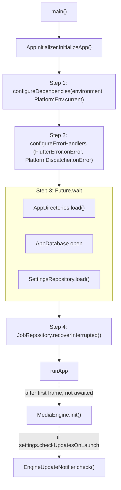

# App Startup

> Status: planned. Files: `lib/main.dart`, `lib/core/app_initializer.dart`, `lib/ui/application.dart`, `lib/ui/startup/`.

What happens from launch to the first screen.

## Entry Point

`lib/main.dart` runs, in order:

1. `WidgetsFlutterBinding.ensureInitialized()`.
2. `await AppInitializer.initializeApp()`.
3. On success: `runApp(const ProviderScope(child: MediaDownloaderApp()))`.
4. On failure: `runApp(StartupErrorApp(...))`, a minimal screen with the error and a **Retry** button (re-runs `initializeApp`).

## AppInitializer

| Step | What | Why it's here |
| --- | --- | --- |
| 1 | DI with the platform environment | Only this platform's engine and export service get registered. See [Architecture: DI](architecture.md#dependency-injection). |
| 2 | Uncaught error hooks | Route uncaught errors into `ErrorHandler`'s recorders (local log only, nothing leaves the device). |
| 3 | Directories, database, settings | Needed by the first screen. Run in parallel. |
| 4 | Recover interrupted jobs | Jobs left in `downloading`/`processing` from a killed app become `failed` with a **Retry** action; their partial files are deleted. |

### Engine init runs after the first frame

`MediaEngine.init()` can take several seconds on first launch (Android unpacks Python + yt-dlp + ffmpeg; iOS unpacks the Python standard library). It must not block the UI:

- `EngineStatusNotifier` (keep-alive) calls `init()` after the first frame and exposes `initializing` / `ready` / `failed`.
- The Download screen still lets you paste; the preview sheet shows "Preparing download engine…" until `ready`, then probes automatically.
- If `init()` fails, the Download screen shows an `ErrorState` with **Retry** and a link to [Troubleshooting](../utils/troubleshooting.md).

## Root Widget: MediaDownloaderApp

- Builds `MaterialApp.router` with the auto_route config, `buildTheme(Brightness.light/dark)` and `themeMode` from settings (system by default).
- Watches `didChangeMetrics` to update `ScreenTypeNotifier`.
- Wraps the router in the toast host used by `ToastUtil`.

## One-time Rights Notice

On the first launch (no `rightsNoticeAccepted` key in settings), the home shell shows a dialog before anything else: users are responsible for having the rights to what they download. **I understand** stores the flag. It can be re-read from Settings → About.

## Share Intent (later)

Receiving a link from another app's share sheet (Android `ACTION_SEND`, iOS share extension) would open the app on Download with the link pasted. Not in v1; the startup flow should leave room for an initial link argument.
