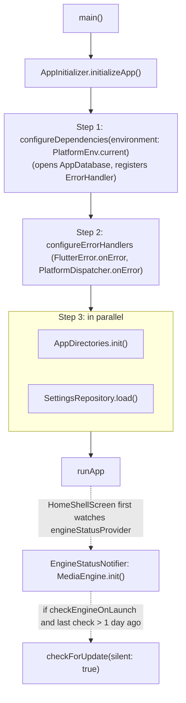

# App Startup

> Status: implemented (untested on devices). Files: `lib/main.dart`, `lib/core/app_initializer.dart`, `lib/ui/application.dart`, `lib/ui/startup/`.

What happens from launch to the first screen.

## Entry Point

`lib/main.dart` calls `WidgetsFlutterBinding.ensureInitialized()` and then `runMediaDownloaderApp()` (`lib/ui/startup/run_media_downloader_app.dart`), which:

1. Awaits `AppInitializer.initializeApp()` (returns `true` / `false`, never throws).
2. On success: `runApp(const ProviderScope(child: MediaDownloaderApp()))`.
3. On failure: `runApp(const StartupErrorApp(onRetry: runMediaDownloaderApp))`, a minimal screen (`EmptyState` + **Retry**) that runs the whole sequence again.

## AppInitializer

| Step | What | Why it's here |
| --- | --- | --- |
| 1 | DI with the platform environment | Only this platform's engine, file export and background-work services get registered. `configureDependencies` also registers the database, the error log and `ErrorHandler` (with its translators and recorders) before injectable runs. See [Architecture: DI](architecture.md#dependency-injection). |
| 2 | Uncaught error hooks | Route uncaught errors into `ErrorHandler`'s recorders (local log only, nothing leaves the device). |
| 3 | Directories, settings | Needed by the first screen. Run in parallel (record `.wait`). A failed settings read is recorded and the app starts with defaults. |

Steps 1–2 run only once, even when **Retry** calls `initializeApp()` again.

### Interrupted jobs

There is no separate recovery step. `DownloadQueueNotifier` loads saved jobs through `JobRepository.getAll()`, which turns any job still `queued` or active in storage (the app was killed) into `failed` with "The app was closed during this download." and a **Retry** action.

### Engine init runs after the first frame

`MediaEngine.init()` can take several seconds on first launch (Android unpacks Python + yt-dlp + ffmpeg; iOS unpacks the Python standard library). It must not block the UI:

- `EngineStatusNotifier` (keep-alive) starts `init()` in a microtask the first time it's watched (by `HomeShellScreen`) and exposes `initializing` / `ready` / `failed`.
- The Download screen still lets you paste; the preview sheet waits (`waitingForEngine`) until `ready`, then probes automatically.
- If `init()` fails, the preview sheet shows the error in place with **Retry**, which re-runs `init()`.
- Once ready, the launch update check runs at most once a day when **Check on launch** is on. It never updates by itself; an available update puts a badge on the Settings tab. See [Settings](../features/settings.md#engine).

## Root Widget: MediaDownloaderApp

- Builds `MaterialApp.router` with the auto_route config, `buildTheme(.light)` / `buildTheme(.dark)` and `themeMode` from settings (system by default).
- Watches `didChangeMetrics` and updates `ScreenTypeNotifier` in a post-frame callback.
- Toasts need no host widget: `ToastUtil` (on `flutter_sliding_toast`) shows them over the current context.

## One-time Rights Notice

On the first launch (`rightsNoticeAccepted` is false in settings), `HomeShellScreen` shows a dialog after its first frame: users are responsible for having the rights to what they download. Closing it stores the flag. It can be re-read from Settings → About.

## Share Intent (later)

Receiving a link from another app's share sheet (Android `ACTION_SEND`, iOS share extension) would open the app on Download with the link pasted. Not in v1.
