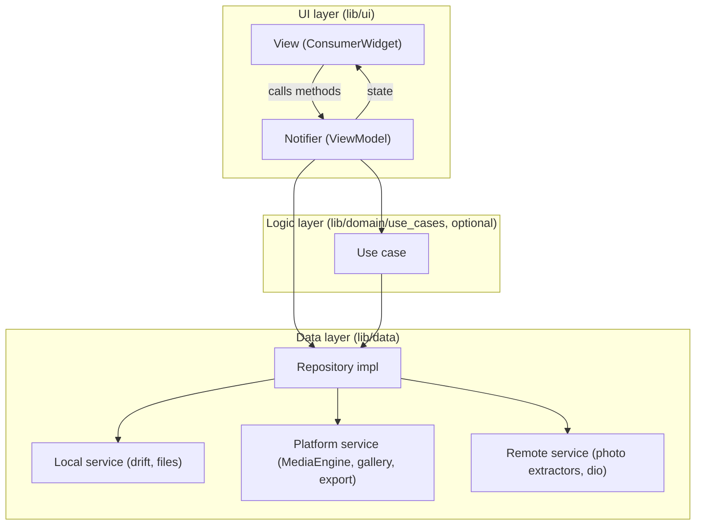
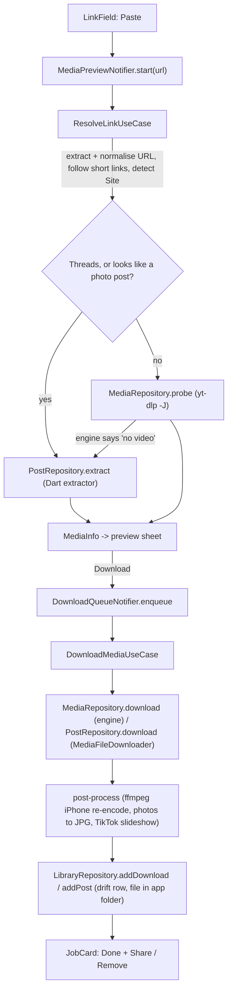

# Architecture

> Status: implemented (all v1 steps; untested on devices).

Media Tool uses **MVVM** (Model-View-ViewModel), following Flutter's official app architecture guidelines. It is **feature-first**, uses **Riverpod** for state management and **get_it + injectable** for dependency injection, and keeps business logic out of widgets.

- **UI layer:** Views (screens, widgets) and ViewModels (Riverpod `Notifier`s), grouped by feature.
- **Logic layer (optional):** use cases, for flows that combine several repositories.
- **Data layer:** repositories and services, grouped by type.

There is **no backend**. "Remote" here means the social sites themselves (fetched by the photo extractors), and the heavy work happens in the on-device **media engine** (yt-dlp + ffmpeg), which is a platform service.

## Table of Contents

- [Project Structure](#project-structure)
- [Layers](#layers)
- [State Management with Riverpod](#state-management-with-riverpod)
- [Dependency Injection](#dependency-injection)
- [Data States](#data-states)
- [Data Flow](#data-flow)
- [Media Engine](#media-engine)
- [Responsiveness](#responsiveness)
- [Docs Map](#docs-map)

## Project Structure

```text
lib/
├── config/
│   ├── injector/            # get_it + injectable setup, PlatformEnv (android / ios / macos)
│   └── pigeon/              # Pigeon inputs: media_engine_api, file_export_api, background_work_api, system_monitor_api
├── core/
│   ├── clients/
│   │   ├── database/        # AppDatabase (drift) + tables/
│   │   └── platform/        # generated Pigeon Dart clients
│   ├── data/
│   │   └── states/          # DataState, SuccessState, FailureState, LoadingState
│   ├── errors/              # ErrorHandler, error flows, translators, recorders, engine/extractor errors
│   ├── messages/            # app_messages.dart (every user-facing string)
│   ├── services/            # AppDirectories, FileService, ClipboardService
│   ├── types/               # FutureData, FutureList, FutureVoid, StreamData typedefs
│   ├── utils/               # url_utils, filename_utils, format_utils, mime_utils
│   └── app_initializer.dart
├── data/
│   ├── models/
│   │   ├── mappers/         # MediaInfoMapper, PostMapper, SystemSampleMapper
│   │   └── responses/       # DTOs: yt-dlp JSON, extracted posts, local media info
│   ├── repositories/        # Media, Post, Library, Job, Convert, Settings, Cookies, AppInfo, BackgroundWork, SystemMonitor
│   └── services/
│       ├── local/           # LibraryLocalService, JobLocalService, SettingsLocalService, CookiesLocalService, ErrorLogLocalService, AppFilesLocalService
│       ├── platform/        # media_engine/ (Android + macOS engines, builders, parsers, FfmpegSlot), file_export/, background_work/,
│       │                    # system_monitor/, GalleryService, ShareService, FilePickerService, MediaPickerService,
│       │                    # ImageService, ImageConvertService, AppInfoService
│       └── remote/          # SiteHttpClient, extractors/ (Instagram, TikTok, Facebook, Threads, X), MediaFileDownloader, EngineReleaseService
├── domain/
│   ├── models/              # Site, MediaInfo, VideoOption, DownloadRequest, DownloadJob, JobProgress, LibraryItem, ConvertRequest, AppSettings, SystemSample, DeviceStorage, BatteryStatus, ...
│   ├── repositories/        # abstract contracts
│   └── use_cases/           # ResolveLinkUseCase, DownloadMediaUseCase, ConvertMediaUseCase
├── routing/
│   └── routes.dart          # auto_route config (AppRouter)
├── ui/
│   ├── core/
│   │   ├── providers/       # BaseNotifier, BaseState, ErrorTracking, ScreenTypeNotifier
│   │   ├── themes/          # design tokens, see design_system.md
│   │   ├── ui/base/         # design-system widgets
│   │   └── utils/           # ToastUtil, ref extensions, local media helpers
│   ├── features/
│   │   ├── home/            # shell: bottom nav / sidebar, 5 tabs
│   │   ├── download/        # paste -> preview -> queue (Share / Remove on finished jobs), engine status
│   │   ├── library/         # all items, media viewer, Save to Photos / Files, Share, Delete
│   │   ├── convert/         # pick -> convert or compress -> result
│   │   ├── system/          # system monitor (network / battery / RAM / CPU / GPU / storage)
│   │   └── settings/        # defaults, cookies, storage, engine update, about, design gallery
│   ├── startup/             # runMediaToolApp, StartupErrorApp, one-time rights notice
│   └── application.dart     # MediaToolApp (MaterialApp.router)
└── main.dart
```

Each feature follows:

```text
lib/ui/features/<feature>/
    ├── models/       # UI-only models
    ├── providers/    # Notifiers (ViewModels)
    ├── widgets/      # widgets shared by this feature's screens
    └── views/
        └── <screen>/
            ├── <screen>_screen.dart
            └── widgets/  # widgets only this screen uses
```

There are no flavors: it's a personal app with one build. `lib/main.dart` is the only entry point.

## Layers



- **Views** render state and forward user actions. They show toasts and dialogs and navigate, reacting to state through `ref.listen`.
- **Notifiers** hold screen state and call repositories or use cases. They never touch `BuildContext`, never show toasts and never navigate.
- **Use cases** combine repositories for one flow, e.g. `DownloadMediaUseCase` (engine or direct download → iPhone re-encode / JPG → library row).
- **Repositories** are the only thing notifiers and use cases talk to. They map DTOs to domain models and return `DataState<T>`.
- **Services** do one kind of I/O each and wrap every call in `ErrorHandler.execute`.

## State Management with Riverpod

Rules:

- Every notifier extends `BaseNotifier` / `BaseAsyncNotifier` / `BaseStreamNotifier`; every state extends `BaseState` (`StateStatus` + `StateMessage`).
- `copyWith` never keeps the old `message`: it takes the argument as given, so a message can be cleared.
- A notifier runs each user flow in `runFlow('<flow label>', ...)` and reports failures with `trackFailure(dataState)` / `trackError(text)`. See [Error Handling](../core/error_handling.md).
- Text comes from `lib/core/messages/app_messages.dart`. See [App Messages](../core/app_messages.md).
- An `.autoDispose` notifier can be disposed during an `await` (e.g. the preview sheet closes mid-probe). Check `ref.mounted` before touching state after an `await`.
- A notifier that calls another notifier captures it once in `build()`, never through a lazy getter.

Long-running work (downloads, conversions) is owned by **keep-alive** notifiers (`DownloadQueueNotifier`, `ConvertJobNotifier`, plain `NotifierProvider`s), so leaving a screen never cancels a job. Screen-scoped notifiers (preview sheet, media viewer, cookies, about, storage, system monitor) are `.autoDispose`.

## Dependency Injection

- `get_it` + `injectable`; annotate with `@injectable`, `@lazySingleton` or `@singleton` and run `dart run build_runner build`.
- Platform-specific implementations use injectable **environments**, one per platform (`android`, `ios`, `macos`, in `lib/config/injector/platform_env.dart`). `configureDependencies()` passes the running platform's environment, so only that platform's classes are registered:

```dart
// iOS reuses the same Dart engine: its Swift side implements the same Pigeon API.
@LazySingleton(as: MediaEngine, env: [PlatformEnv.android, PlatformEnv.ios])
final class AndroidMediaEngine implements MediaEngine { ... }

@LazySingleton(as: MediaEngine, env: [PlatformEnv.macos])
final class MacosMediaEngine implements MediaEngine { ... }

// app_initializer.dart
await configureDependencies(environment: PlatformEnv.current); // 'android' | 'ios' | 'macos'
```

The same applies to `FileExportService` (one implementation per platform) and `BackgroundWorkService` (Android foreground service; a no-op on iOS and macOS).

`configureDependencies` registers the database, the error log and `ErrorHandler` by hand before calling the generated initializer, because everything else depends on them.

## Data States

`DataState<T>` is a sealed class: `SuccessState<T>`, `FailureState<T>`, `LoadingState<T>` (in `lib/core/data/states/`). Repositories return `Future<DataState<T>>` or `Stream<DataState<T>>`. Methods with no result use `FutureVoid` and return `const SuccessState.nil()` on success.

Progress streams (`Stream<DataState<JobProgress>>`) emit `SuccessState` for each progress update and end with one `SuccessState` (completed) or one `FailureState`.

## Data Flow

Download, from paste to library:



Details: [Download](../features/download.md), [Library](../features/library.md), [Convert](../features/convert.md).

## Media Engine

`MediaEngine` is the single Dart interface over yt-dlp and ffmpeg. The implementations live in `lib/data/services/platform/media_engine/`:

| Platform | Implementation | How it talks |
| --- | --- | --- |
| Android | `AndroidMediaEngine` | Pigeon `@HostApi` + `@EventChannelApi` → Kotlin (youtubedl-android) |
| iOS | `AndroidMediaEngine` (same Dart class) | The same Pigeon API → Swift → embedded CPython running the yt-dlp CLI; ffmpeg from FFmpegKit |
| macOS | `MacosMediaEngine` | `dart:io` `Process` running bundled `yt-dlp_macos`, `ffmpeg`, `ffprobe` |

See [Media Engine](../engine/media_engine.md).

## Responsiveness

`ScreenTypeNotifier` tracks the breakpoint (phone / tablet / desktop). The root widget listens for `didChangeMetrics` and updates it in a post-frame callback. Layout rules are in the [Design System](../design/design_system.md#layout-and-navigation).

## Docs Map

| Area | Doc |
| --- | --- |
| Startup | [App Startup](app_startup.md) |
| SDK, lints, codegen | [Development](development.md) |
| Look and feel | [Design System](../design/design_system.md) |
| Routing | [Routing](../core/routing.md) |
| Errors | [Error Handling](../core/error_handling.md) |
| Strings | [App Messages](../core/app_messages.md) |
| Database | [Local Database](../core/local_database.md) |
| Files, permissions, thumbnails | [Core Services](../core/core_services.md) |
| Engine | [Media Engine](../engine/media_engine.md), [Android](../engine/android_engine.md), [iOS](../engine/ios_engine.md), [macOS](../engine/macos_engine.md), [ffmpeg Recipes](../engine/ffmpeg_recipes.md), [Site Support](../engine/site_support.md) |
| Photo posts | [Photo Extractors](../extractors/photo_extractors.md) |
| Features | [Download](../features/download.md), [Library](../features/library.md), [Convert](../features/convert.md), [System](../features/system.md), [Settings](../features/settings.md) |
| Packages, problems | [Packages](../utils/packages.md), [Troubleshooting](../utils/troubleshooting.md) |
