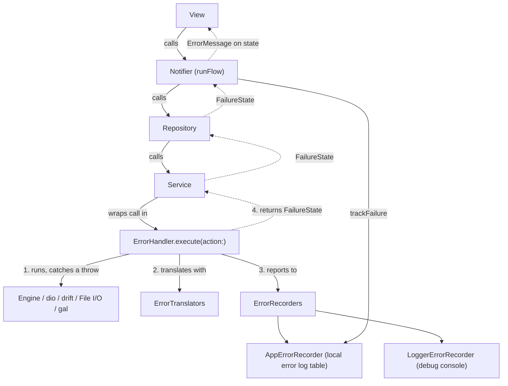

# Error Handling

> Status: built. Files: `lib/core/errors/`, `lib/ui/core/providers/base/error_tracking.dart`. No crash reporting: errors never leave the device.

## Overview

An exception is caught at the bottom (in a service or repository), translated into a `FailureState` with a user message, recorded, and travels back up. A notifier then decides whether to show it.



## ErrorHandler

`ErrorHandler` (`error_handler.dart`, registered through `ErrorHandlerProvider.register` in `lib/config/injector/injector.dart`):

- `execute<T>(callback, action:)`: runs the callback; on a throw, translates it to `FailureState<T>`, gives it an error id and stack trace, records it and returns it. A returned `FailureState` gets the `action` added to its action path too. The `action:` label names the exact operation (`'engine.probe'`, `'extractor.instagram'`, `'library.deleteByIds'`).
- `executeStream<T>(stream, action:)`: wraps each value in a `SuccessState`; an error event is translated, recorded and sent on as a `FailureState` event, and the stream keeps going (e.g. `LibraryRepository.watchItems()` over drift's `watchAll()`).
- `executeSafe()` / `executeSafeReturn(onError:)`: record but don't propagate (best-effort work such as a video still for a thumbnail or deleting temp files).
- `configureErrorHandlers()` hooks every recorder into uncaught errors (`FlutterError.onError`, `PlatformDispatcher.onError`).

`ErrorFlow` (`error_flow.dart`) carries the current user flow (`action`) and notifier (`source`) in a `Zone`, so an error recorded deep in the data layer knows which flow it broke without every method taking a parameter.

## Translators

Tried in this order; the first that matches wins. Anything unmatched becomes a `FailureState` whose message defaults to `CommonMessages.genericError`.

| Translator | Turns | Into the message |
| --- | --- | --- |
| `FileSystemErrorTranslator` | `FileSystemException` | `CommonMessages.noSpace` (errno 28) or `storageError` |
| `GalleryErrorTranslator` | `GalException` (Save to Photos) | Photos access denied / no space / unsupported format / save failed |
| `ExtractorErrorTranslator` | `ExtractorException` from a photo extractor | `ExtractorMessages` for `loginRequired` (names the site), `notFound`, `noMedia`, `broken` |
| `DioErrorTranslator` | `DioException` (extractors, direct downloads) | 401/403 → forbidden, 404/410 → not found, 429 → rate limited, timeouts/connection → network, else download failed. The logged error keeps host + path only. |
| `EngineErrorTranslator` | `EngineException` (stderr, thrown in Dart) and `PlatformException` (from the native engine) | Matched by text, see below |

Failures carry a **message string**, not typed failure classes: the UI compares the message (e.g. a failed job card offers **Update engine** for `EngineMessages.extractorBroken` and **Cookies** for `needsLogin` / `botCheck`).

### Engine error mapping

yt-dlp's messages are matched by text, since they're the only signal. The patterns live in one table, `EngineErrors` (`engine_errors.dart`), most specific first, so they're easy to update when yt-dlp changes wording.

| yt-dlp / ffmpeg output matches | Message (`EngineMessages`) | Notes |
| --- | --- | --- |
| `not a bot` | `botCheck`: "YouTube wants a sign-in. Import YouTube cookies in Settings, or try again later." | Job card: **Cookies** |
| `private`, `log in` / `login`, `logged-in`, `login required`, `sign in`, `registered users`, `--cookies`, `members-only`, `age-restricted` (checked after `not a bot`) | `needsLogin`: "…Import cookies for this site in Settings." | Job card: **Cookies** |
| `Unsupported URL` | `unsupported` | |
| `No video formats found`, `There is no video`, `No video could be found` | `noVideo` | `ResolveLinkUseCase` tries the photo extractor instead |
| `unavailable`, `has been removed`, `does not exist`, `not found`, `HTTP Error 404` | `unavailable` | |
| `Requested format is not available` | `formatUnavailable` | |
| `HTTP Error 403`, `Forbidden` | `forbidden` | |
| `Unable to download webpage`, `getaddrinfo`, `Network is unreachable`, `timed out`, `Connection reset`, `SSL` | `network` | |
| `No space left` | `CommonMessages.noSpace` | |
| `Unable to extract`, `Unable to parse`, `please report this issue`, `KeyError`, `JSONDecodeError` | `extractorBroken`: "The site changed. Update the download engine, then try again." | Job card: **Update engine** |
| anything else | `failed` | |

## Recorders

- `AppErrorRecorder`: writes to the `ErrorLogLocal` drift table (time, action path, source notifier, message, error, whether it was shown). Capped at the last 500 entries. `trackFailure` marks an already-recorded failure as shown instead of adding a second row. Visible in Settings → About → Error log as a **Copy** button, so the user can paste it into an issue themselves.
- `LoggerErrorRecorder`: prints in debug builds only.
- No Crashlytics or any other remote reporting (see the guardrails in `CLAUDE.md`).

Never record cookies, full cookie file contents or authorisation headers. `AppErrorRecorder` strips query strings and fragments from every URL it stores; `ExtractorException.detail` and the dio translator never include them.

## In Notifiers

`ErrorTracking` (mixed into the base notifiers) gives `runFlow`, `trackFailure` and `trackError`:

```dart
Future<void> _resolve({bool useEngine = true}) => runFlow('download.probe', () async {
  final result = await _resolveLink.run(url, useEngine: useEngine);
  switch (result) {
    case SuccessState(:final data?):
      state = state.copyWith(previewStatus: .loaded, info: data);
    default:
      state = state.copyWith(previewStatus: .failed, errorText: trackFailure(result).text);
  }
});
```

One label per user flow; data-layer labels are different, so the action path in the log (`download.probe > engine.probe`) shows which step failed. `trackFailure` / `trackError` assert they're called inside `runFlow` (or with an explicit `action:`).
