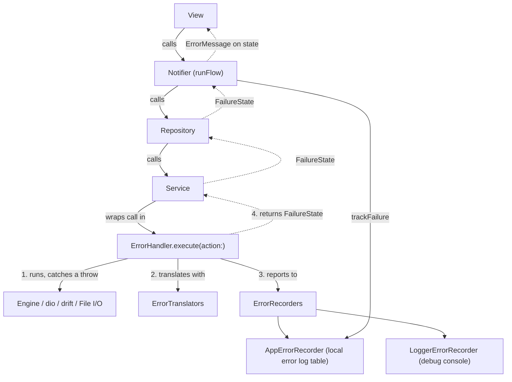

# Error Handling

> Status: planned. Files: `lib/core/errors/`. Same design as vAIolin, minus Crashlytics: errors never leave the device.

## Overview

An exception is caught at the bottom (in a service), translated into a `FailureState`, recorded, and travels back up. A notifier then decides whether to show it.



## ErrorHandler

- `execute<T>(callback, action:)`: runs the callback; on a throw, translates it to `FailureState<T>`, records it and returns it. The `action:` label names the exact operation (`'engine.probe'`, `'extractor.instagram'`, `'library.delete'`).
- `executeSafe()` / `executeSafeReturn()`: record but don't propagate (used for best-effort work such as thumbnail generation or deleting temp files).

## Translators

| Translator | Turns | Into |
| --- | --- | --- |
| `EngineErrorTranslator` | yt-dlp / ffmpeg error output (from any engine) | Typed failures, see below |
| `DioErrorTranslator` | `DioException` (extractors, photo downloads) | `NetworkFailure`, `HttpStatusFailure(code)`, `TimeoutFailure` |
| `FileSystemErrorTranslator` | `FileSystemException`, `PathNotFoundException` | `StorageFailure` (disk full, missing file, no permission) |
| `PlatformErrorTranslator` | `PlatformException` from Pigeon / gal / share | `PermissionFailure`, `PlatformFailure` |
| `DefaultErrorTranslator` | anything else | `UnknownFailure` |

### Engine error mapping

yt-dlp's messages are matched by text, since they're the only signal. Keep the patterns in one table (`engine_error_patterns.dart`) so they're easy to update when yt-dlp changes wording.

| yt-dlp / ffmpeg output contains | Failure | What the user sees |
| --- | --- | --- |
| `There is no video in this post` | `NoVideoFailure` | Not shown: `ResolveLinkUseCase` retries with the photo extractor |
| `Private video`, `This video is private`, `login required`, `cookies` | `LoginRequiredFailure(site)` | "This post needs you to be logged in. Import cookies in Settings." + **Open Settings** |
| `Sign in to confirm you're not a bot` | `BotCheckFailure` | "YouTube wants a sign-in. Import YouTube cookies, or try again later." |
| `Video unavailable`, `HTTP Error 404` | `NotFoundFailure` | "This post was deleted or isn't available." |
| `Unsupported URL` | `UnsupportedSiteFailure` | "This link isn't supported." |
| `HTTP Error 429`, `rate-limit` | `RateLimitedFailure` | "The site is limiting downloads. Try again in a few minutes." |
| `Requested format is not available` | `FormatUnavailableFailure` | "That quality isn't available. Pick another one." |
| `No space left on device` | `StorageFailure` | "Not enough storage." |
| extractor / `ERROR: [..] Unable to extract` | `ExtractorBrokenFailure` | "The site changed. Update the engine in Settings." + **Update** |

## Recorders

- `AppErrorRecorder`: writes to the `ErrorLogLocal` drift table (time, action path, failure type, short message, whether it was shown). Capped at the last 500 entries. Visible in Settings → About → Error log, with **Copy** so the user can paste it into an issue themselves.
- `LoggerErrorRecorder`: prints in debug builds.
- No Crashlytics or any other remote reporting (see the guardrails in `CLAUDE.md`).

Never record cookies, full cookie file contents or authorisation headers. Recorders strip query strings from URLs.

## In Notifiers

```dart
Future<void> probe(String link) => runFlow('download.probe', () async {
  final result = await _resolveLink(link);
  switch (result) {
    case SuccessState(:final data): state = state.copyWith(status: .loaded, info: data);
    case FailureState(): trackFailure(result);
  }
});
```

One label per user flow; data-layer labels are different, so the action path in the log (`download.probe > engine.probe`) shows which step failed.
