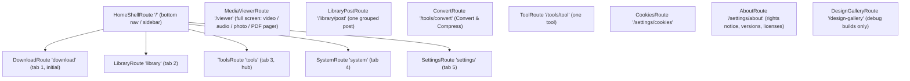

# Routing

> Status: built. File: `lib/routing/routes.dart` (generated `routes.gr.dart`).

`auto_route` with one shell route for the five tabs. Only Views navigate (`context.router` / `context.tabsRouter`): notifiers set state and the View decides. There is no navigation client outside the widget tree.

## Route Tree

- The shell is an `AutoTabsRouter` over `DownloadRoute`, `LibraryRoute`, `ToolsRoute`, `SystemRoute`, `SettingsRoute` (order matches `NavDestination` in `lib/ui/features/home/models/nav_destination.dart`). Switching tabs keeps each tab's state.
- `MediaViewerRoute`, `LibraryPostRoute`, `ConvertRoute`, `ToolRoute`, `CookiesRoute`, `AboutRoute` and `DesignGalleryRoute` are top-level routes, pushed **above** the shell (full screen, no nav bar).
- `MediaViewerRoute(initialId:, ids:)` takes the tapped item's id plus the ids to page through (the visible single items of the Library, the items of one post on its post page, or one finished job's / tool's result), so you can swipe to the next item. It's opened from the Library grid and from a finished job card on Download.
- `CookiesRoute` is pushed from Settings → Cookies and from the **Cookies** button on a failed job card; `AboutRoute` from Settings → About.
- `DesignGalleryRoute` is registered in every build, but its Settings entry is shown only when `kDebugMode`.
- The **preview** after pasting is an inline card on the Download screen, not a route or sheet: closing it keeps you on Download with the link still in the field, and switching tabs keeps it open.
- `LibraryPostRoute(groupId:)` is pushed when a grouped card is tapped in the Library, and from a tool's **Open** when it made several files.
- `ConvertRoute` is pushed from the Tools hub's **Convert & compress** card, and by a Library item's **Convert** action after `ConvertSourceNotifier.pickFromLibrary(id)` (so it opens with that item chosen). It takes no arguments.
- `ToolRoute(tool:)` is pushed from a tool card on the Tools hub.

## Guards

None: no login, no roles. The one-time rights notice is a dialog shown by the shell after the first frame, not a guard (see [App Startup](../architecture/app_startup.md#one-time-rights-notice)).

## Keyboard Shortcuts

None yet (no macOS menu items or ⌘ shortcuts are wired up).
