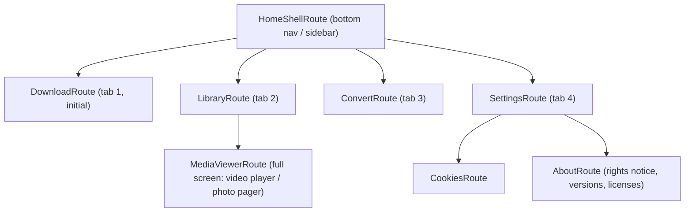

# Routing

> Status: planned. Files: `lib/routing/routes.dart`, `lib/routing/navigation_client.dart`.

`auto_route` with one shell route for the four tabs. `NavigationClient` allows navigation without a `BuildContext` (used by toasts and deep links), but only Views trigger navigation: notifiers set state and the View decides.

## Route Tree

- Each tab keeps its own navigation stack (`AutoTabsRouter`), so switching tabs doesn't lose scroll position or an open viewer.
- `MediaViewerRoute` is pushed **above** the shell (full screen, no nav bar). It takes a `LibraryItem` id plus the ids of the current filtered list, so you can swipe to the next item.
- The **preview** after pasting is a bottom sheet (`AppBottomSheet`) on phones and a side panel on wide screens, not a route: closing it keeps you on Download with the link still in the field.
- Convert can be opened with an input: `ConvertRoute(initialItemId: ...)` from a Library item's **Convert** action switches to tab 3 with that item preselected.

## Guards

None for now: no login, no roles. The one-time rights notice is a dialog shown by the shell, not a guard (see [App Startup](../architecture/app_startup.md#one-time-rights-notice)).

## macOS Menu and Shortcuts

| Shortcut | Action |
| --- | --- |
| ⌘V (anywhere) | Switch to Download and paste |
| ⌘1–⌘4 | Switch tab |
| ⌘, | Settings |
| ⌘⌫ | Delete selected Library item (confirm first) |
