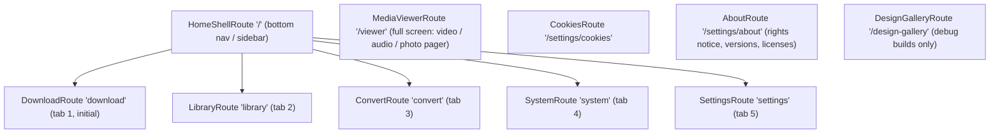

# Routing

> Status: built. File: `lib/routing/routes.dart` (generated `routes.gr.dart`).

`auto_route` with one shell route for the five tabs. Only Views navigate (`context.router` / `context.tabsRouter`): notifiers set state and the View decides. There is no navigation client outside the widget tree.

## Route Tree

- The shell is an `AutoTabsRouter` over `DownloadRoute`, `LibraryRoute`, `ConvertRoute`, `SystemRoute`, `SettingsRoute` (order matches `NavDestination` in `lib/ui/features/home/models/nav_destination.dart`). Switching tabs keeps each tab's state.
- `MediaViewerRoute`, `CookiesRoute`, `AboutRoute` and `DesignGalleryRoute` are top-level routes, pushed **above** the shell (full screen, no nav bar).
- `MediaViewerRoute(initialId:, ids:)` takes the tapped item's id plus the ids to page through (the current filtered Library list, or the items of one carousel group / one finished job), so you can swipe to the next item. It's opened from the Library grid and from a finished job card on Download.
- `CookiesRoute` is pushed from Settings → Cookies and from the **Cookies** button on a failed job card; `AboutRoute` from Settings → About.
- `DesignGalleryRoute` is registered in every build, but its Settings entry is shown only when `kDebugMode`.
- The **preview** after pasting is a bottom sheet (`showAppBottomSheet`, max width 640) on every screen size, not a route: closing it keeps you on Download with the link still in the field.
- A Library item's **Convert** action calls `ConvertSourceNotifier.pickFromLibrary(id)` and then `context.router.navigate(const ConvertRoute())`, which switches to tab 3 with that item already chosen. `ConvertRoute` takes no arguments.

## Guards

None: no login, no roles. The one-time rights notice is a dialog shown by the shell after the first frame, not a guard (see [App Startup](../architecture/app_startup.md#one-time-rights-notice)).

## Keyboard Shortcuts

None yet (no macOS menu items or ⌘ shortcuts are wired up).
