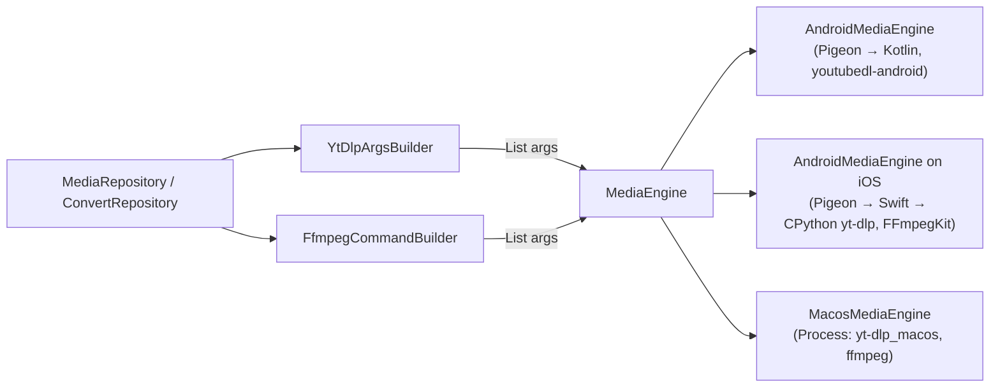

# Media Engine

> Status: implemented on Android, iOS and macOS (not yet tested on real devices). Files: `lib/data/services/platform/media_engine/`.

`MediaEngine` is the one Dart interface over yt-dlp (download) and ffmpeg (process, convert, read local files). The UI and repositories never know which platform they're on.

## Interface

```dart
abstract interface class MediaEngine {
  /// Unpacks / prepares yt-dlp, Python and ffmpeg. Returns the yt-dlp version and ffmpeg's video encoders.
  FutureData<EngineInfo> init();

  /// Runs `yt-dlp -J` (args from YtDlpArgsBuilder.probe).
  FutureData<ProbeResponseDto> probe(List<String> args);

  /// Runs yt-dlp for jobId. The stream ends after its last event.
  Stream<EngineEvent> download(String jobId, List<String> args);

  /// Runs ffmpeg for jobId. The stream ends after its last event.
  Stream<EngineEvent> ffmpeg(String jobId, List<String> args);

  Future<void> cancel(String jobId);

  /// Updates yt-dlp in place and returns the version after the update.
  FutureData<String> updateYtDlp();
}
```

`EngineEvent` is sealed: `EngineLine(text)` (one stdout line), `EngineDone`, `EngineFailed(output)` (the tail of stderr, at most 4000 characters) and `EngineCancelled`. Each job's stream ends after its first non-line event.

The **commands are built once in Dart** (`YtDlpArgsBuilder`, `FfmpegCommandBuilder` in `media_engine/builders/`), so presets, file names and quality rules are identical on all three platforms. Each platform engine only knows how to *run* yt-dlp and ffmpeg. There is no separate `probeFile`: local files are read with `ffmpeg -i` (see [Reading Local Files](#reading-local-files)).

| Platform | Dart class | How it runs |
| --- | --- | --- |
| Android | `AndroidMediaEngine` | Pigeon `MediaEngineHostApi` + `MediaEngineEventsApi` → Kotlin (youtubedl-android) |
| iOS | `AndroidMediaEngine` (same class) | The same Pigeon API → Swift `IosMediaEngine`: embedded CPython running yt-dlp's CLI entry point, FFmpegKit in-process |
| macOS | `MacosMediaEngine` | `dart:io` `Process` running the bundled `yt-dlp_macos` and `ffmpeg` |

The Pigeon bridge is identical on Android and iOS and both native sides emit the same stdout lines, so one Dart class serves both: it's registered with `@LazySingleton(as: MediaEngine, env: [PlatformEnv.android, PlatformEnv.ios])`. There is no `ios_media_engine.dart`.



## Probe

`YtDlpArgsBuilder.probe(url, cookiesPath:, browser:)`:

```
-J --no-playlist --no-warnings [--cookies <file> | --cookies-from-browser <browser>] URL
```

`MediaRepositoryImpl.probe` builds the args, `ProbeResponseDto` keeps only what the app needs from the JSON, and `MediaInfoMapper` turns it into `MediaInfo`:

- **Quality options:** tiers 2160 / 1440 / 1080 / 720 / 480 / 360 by the format's short side (so portrait videos land in the right tier), plus **Best** first. Each option's size = the highest-bitrate video format in that tier (`filesize`, else `filesize_approx`, else bitrate × duration) + the best audio, unless that format already has audio. Unknown size shows as "~". A clip below 360p still gets one option.
- **Audio:** 320 / 192 / 128 kbps MP3 (`AudioQuality`), size = duration × bitrate.
- **iPhone re-encode flag:** per option, `hasH264` says whether any format in that tier is H.264. When it isn't (YouTube VP9/AV1 above 1080p) and iPhone-compatible is on, the preview shows the re-encode hint and the download runs the iPhone re-encode afterwards.
- **Preview stream:** the best *progressive* format (video + audio) up to 720p and its `http_headers`, played with `video_player`. If none exists, the preview shows the thumbnail only.

## Download Args

`YtDlpArgsBuilder.download(request, workDir:, cookiesPath:, browser:)`:

```
--newline --no-playlist --no-mtime --no-warnings
--progress-template "download:[MD]%(progress.downloaded_bytes)s|%(progress.total_bytes)s|%(progress.total_bytes_estimate)s|%(progress.speed)s|%(progress.eta)s"
-o "<work>/<jobId>/media.%(ext)s"
-o "thumbnail:<work>/<jobId>/thumb.%(ext)s"
--write-thumbnail --convert-thumbnails jpg
[--cookies <file> | --cookies-from-browser <browser>]
<format args from ffmpeg_recipes.md>
URL
```

- There is no `--print after_move:filepath`. When yt-dlp exits successfully, `MediaRepositoryImpl` lists `work/<jobId>/`: `thumb.*` is the thumbnail and the **largest** other file (skipping `.part` / `.ytdl`) is the media. Dart then renames it from the title (`FilenameUtils`) and moves it into `downloads/` when it adds the Library row.
- **Cookies, per site:** the site's own imported `cookies/<site>.txt` wins (`--cookies`). Without one, on macOS only, the Settings browser choice adds `--cookies-from-browser safari|chrome|firefox`. Cookies are never passed for other sites.
- **macOS only** prefixes every yt-dlp call with `--ffmpeg-location <bin>` and, when `deno` is bundled, `--js-runtimes deno:<bin>/deno` (see [macOS Engine](macos_engine.md#running)).

## Progress

`DownloadProgressParser` (one per job) turns stdout lines into `JobProgress`:

| Source | Stage | Fields |
| --- | --- | --- |
| `[MD]` progress lines | `downloading` | downloaded, total (or estimate), speed, ETA → fraction |
| `[Merger]` / `[ExtractAudio]` | `processing` | step `merging` / `extractingAudio`, indeterminate |
| `[VideoRemuxer]`, `[VideoConvertor]`, `[EmbedThumbnail]`, `[Metadata]`, `[FixupM3u8]` | `processing` | step `finishing`, indeterminate |
| ffmpeg `-progress pipe:1` `out_time_us` vs the input's duration | `processing` | fraction (and ETA from `speed=`, `FfmpegProgressParser`) |
| Dart move + Library row | `saving` | indeterminate |

A video + audio download reports two downloads in a row. At each `[download] Destination:` line the parser banks the finished stream's bytes, and the fraction is measured against the larger of the probe's size estimate and the bytes seen so far, never going backwards.

All three platforms deliver raw stdout lines (iOS included: the shim runs yt-dlp's CLI entry point, not progress-hook dicts), so this one parser serves every platform.

## Reading Local Files

The converter reads imported files with `FfmpegCommandBuilder.probe(path)` = `ffmpeg -hide_banner -i <file>`. With no output ffmpeg prints the input summary to stderr and exits with an error, so the result arrives as `EngineFailed(output)`. `FfmpegInfoParser` reads duration, the first video stream's codec and size (swapping width/height for a 90° rotation flag, ignoring cover art), and the first audio stream's codec and bitrate. No ffprobe is needed. See [Convert](../features/convert.md).

## Cancel

| Platform | How |
| --- | --- |
| Android | yt-dlp: `YoutubeDL.destroyProcessById(jobId)`; ffmpeg: the `Process` started for that job is destroyed |
| iOS | yt-dlp: the shim raises `JobCancelled` in the job's Python thread (`async_raise`); ffmpeg: the FFmpegKit session is cancelled |
| macOS | SIGTERM to the process and its whole child tree (`pgrep -P`), SIGKILL after 3 s |

After a cancel (or any end of a job) the repository deletes `work/<jobId>/`.

## Updates

Sites change and yt-dlp follows within days, so updating without a new app build is a core feature.

**Check:** `EngineReleaseService` asks GitHub for the latest stable release (`GET https://api.github.com/repos/yt-dlp/yt-dlp/releases/latest`, `tag_name`). It's an anonymous request that sends nothing about the user. `MediaRepositoryImpl.checkForUpdate` compares the tag with the running version (yt-dlp versions are dates, compared part by part). `EngineStatusNotifier` runs the check after the engine starts, at most once a day and only when **Check on launch** is on; it never updates by itself.

**Update:**

| Platform | How |
| --- | --- |
| Android | `YoutubeDL.updateYoutubeDL(context, STABLE)` |
| iOS | Swift downloads the official `yt-dlp` zipapp (pure Python) to `Application Support/engine/yt-dlp.zip`, then the shim unloads yt-dlp and imports the new zip (falling back to the bundled one if it doesn't load) |
| macOS | `yt-dlp -U` on the writable copy in `Application Support/…/engine/yt-dlp_macos` (the bundled binary is inside the signed app and read-only) |

Settings → Engine shows the current version, **Check for updates** and **Update**. See [Settings](../features/settings.md#engine).

## Concurrency

- **Downloads:** at most **2** run at once (`DownloadQueueNotifier._maxParallel`); more wait as `queued`.
- **ffmpeg:** one at a time. `FfmpegSlot` (a lazy singleton) is a FIFO lock shared by `ConvertRepositoryImpl.run` (video/audio conversions and compressions) and `MediaRepositoryImpl._runFfmpeg` (the iPhone re-encode after a download and the TikTok slideshow video). Re-encodes are CPU and battery heavy, so they never run in parallel. Short ffmpeg calls (reading a local file, a thumbnail frame) don't take the slot. Image conversions use `flutter_image_compress` and don't take it either.
- **Encoder fallback:** the re-encode and compress commands are a list, one per encoder from `FfmpegCommandBuilder.iphoneEncoders` (hardware first, `libx264` last); each runs only if the one before failed.

Per-platform details: [Android](android_engine.md), [iOS](ios_engine.md), [macOS](macos_engine.md).
