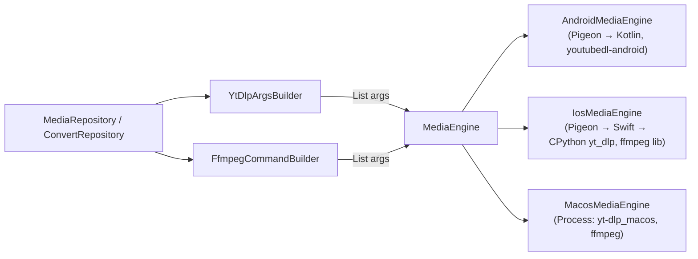

# Media Engine

> Status: planned. Files: `lib/data/services/platform/media_engine/`.

`MediaEngine` is the one Dart interface over yt-dlp (download) and ffmpeg (process, convert). The UI and repositories never know which platform they're on.

## Interface

```dart
abstract interface class MediaEngine {
  /// Unpack/prepare yt-dlp, Python, ffmpeg. Returns versions and available encoders.
  Future<EngineInfo> init();

  /// yt-dlp -J for one URL: title, uploader, duration, thumbnail, formats, preview stream.
  Future<ProbeResponseDto> probe(String url, {String? cookiesPath});

  /// Run yt-dlp with args built by YtDlpArgsBuilder. Emits progress, ends with output paths.
  Stream<EngineProgress> download(EngineDownloadRequest request);

  /// Run ffmpeg with args built by FfmpegCommandBuilder (convert, compress, re-encode, thumbnail).
  Stream<EngineProgress> ffmpeg(String jobId, List<String> args, {Duration? inputDuration});

  /// ffprobe a local file: duration, streams, codecs, size, dimensions.
  Future<LocalMediaInfoDto> probeFile(String path);

  Future<void> cancel(String jobId);

  /// Update yt-dlp in place. Returns the new version.
  Future<String> updateYtDlp();
}
```

Compared with the first sketch in the brief, `convert(ConvertRequest)` became a lower-level `ffmpeg(args)`: the **commands are built once in Dart** (`FfmpegCommandBuilder`, `YtDlpArgsBuilder` in `lib/data/services/platform/media_engine/builders/`), so presets, filenames and quality rules are identical on all three platforms and can be unit-tested without a device. Each platform engine only knows how to *run* yt-dlp and ffmpeg.



## Probe

`yt-dlp -J --no-playlist [--cookies <file>] URL`. `ProbeResponseDto` keeps only what the app needs from the JSON; `MediaInfoMapper` turns it into `MediaInfo`:

- **Quality options:** distinct video heights (2160, 1440, 1080, 720, 480) that exist in `formats`, plus Best. Each option's size estimate = `filesize` or `filesize_approx` of the best video format at that height + the best audio. Unknown size shows as "~".
- **Audio options:** 320 / 192 / 128 kbps MP3. Size estimate = duration × bitrate.
- **iPhone re-encode flag:** per option, `true` when the best video at that height isn't H.264/HEVC (e.g. YouTube VP9/AV1 above 1080p). The preview shows "Will convert for iPhone (slower)" for those.
- **Preview stream:** the best *progressive* format (has both `vcodec` and `acodec`, ≤ 720p) and its `http_headers`, played with `video_player`. If none exists, the preview shows the thumbnail only.

## Download Args

`YtDlpArgsBuilder.build(request)` (tested in [ffmpeg Recipes](ffmpeg_recipes.md)):

```
--newline --no-playlist --no-mtime
--progress-template "download:[MD]%(progress.downloaded_bytes)s|%(progress.total_bytes)s|%(progress.total_bytes_estimate)s|%(progress.speed)s|%(progress.eta)s"
--print after_move:filepath
-o "<work>/<jobId>/%(id)s.%(ext)s"
[--cookies <file>]
<format args from ffmpeg_recipes.md>
URL
```

- Files are written to `work/<jobId>/` under yt-dlp's own id-based name, then **renamed in Dart** (`FilenameUtils`) and moved into `downloads/`. That keeps Unicode filename handling the same on every platform.
- `--print after_move:filepath` gives the final path reliably, even after merging and audio extraction.

## Progress

`EngineProgress` (raw) → `JobProgress` (domain):

| Source | Stage | Fields |
| --- | --- | --- |
| `[MD]` progress lines | `downloading` | downloaded, total (or estimate), speed, ETA → percent |
| `[Merger]`, `[ExtractAudio]`, `[EmbedThumbnail]`, `[Metadata]` lines | `processing` | indeterminate |
| ffmpeg `-progress pipe:1` `out_time_us` vs `inputDuration` | `processing` | percent, ETA |
| Dart move + thumbnail + DB row | `saving` | indeterminate |

Format-merging downloads (video + audio) report two downloads in a row; the mapper weights them by size so the bar doesn't go to 100% and back to 0%.

## Cancel

| Platform | How |
| --- | --- |
| Android | `YoutubeDL.destroyProcessById(jobId)`; for ffmpeg, the process started for that job is destroyed |
| iOS | yt-dlp: the progress hook checks a cancel flag and raises; ffmpeg: the library's session cancel |
| macOS | `Process.kill()` (SIGTERM, SIGKILL after 3 s) |

After a cancel the repository deletes `work/<jobId>/`.

## Updating yt-dlp

Sites change and yt-dlp follows within days, so updating without a new app build is a core feature.

| Platform | How |
| --- | --- |
| Android | `YoutubeDL.updateYoutubeDL(context, STABLE)` |
| iOS | Download the official `yt-dlp` zipapp release (pure Python) into Application Support and put it first on `sys.path`; restart the Python module state |
| macOS | The bundled binary is inside the signed app (read-only), so on first launch it's copied to `Application Support/…/engine/yt-dlp_macos`, and `yt-dlp -U` updates that copy |

Settings → Engine shows the current version and **Update**; with "Check on launch" on, the app checks at most once a day. See [Settings](../features/settings.md#engine).

## Concurrency

At most **2 downloads** and **1 ffmpeg job** run at once (`JobScheduler` in `DownloadQueueNotifier`); more are `queued`. ffmpeg re-encodes are CPU/battery heavy, so they never run in parallel.

Per-platform details: [Android](android_engine.md), [iOS](ios_engine.md), [macOS](macos_engine.md).
