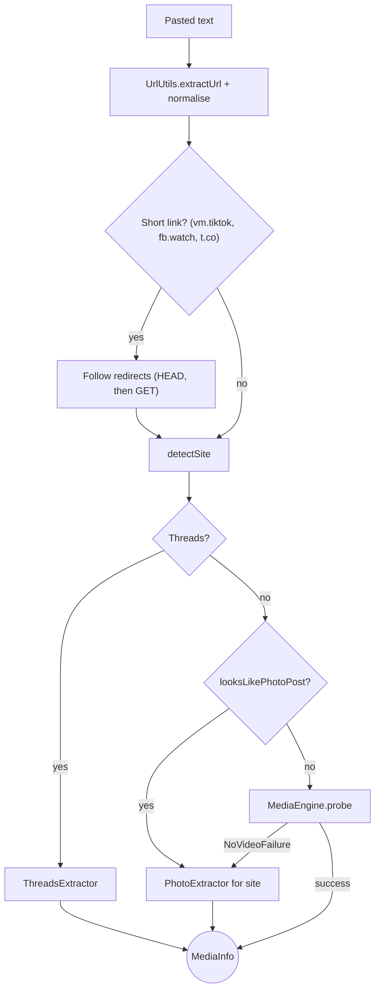

# Photo Extractors

> Status: planned (v1 step 2). Files: `lib/data/services/remote/extractors/`.

yt-dlp only extracts video. On an Instagram photo post it fails with `There is no video in this post`. Photos (and Threads, which yt-dlp doesn't support at all) go through small Dart extractors. They're plain HTTP + HTML/JSON parsing, so they work the same on Android, iOS and macOS with no native code.

## Interface

```dart
abstract interface class PhotoExtractor {
  Site get site;
  bool canHandle(Uri url);
  Future<ExtractedPostDto> extract(Uri url, {String? cookiesPath});
}
```

`ExtractedPostDto` has: post id, author, caption, a list of media (each: URL, kind image/video, width, height), and optional music URL (TikTok slideshows). `MediaInfoMapper` turns it into the same `MediaInfo` the preview uses for videos, with `images` filled.

All requests go through `HttpClient` (dio) with a normal browser User-Agent and `Accept-Language: en`. When the user has imported cookies for that site, they're sent **only** to that site's domain.

## Routing a Link

`ResolveLinkUseCase` (`lib/domain/use_cases/resolve_link_use_case.dart`):



## Instagram

Tested 2026-11-25 on a public photo post; worked without login.

1. Strip tracking params (`?igsh=…`, `?fqnt=…`) and get the shortcode from `/p/<code>/` (also `/reel/`, `/tv/`).
2. Fetch `https://www.instagram.com/p/<shortcode>/embed/captioned/` with a browser User-Agent.
3. Take the `` element and pick the **widest entry in its `srcset`** (gave 1152×1440 WebP).
4. **Carousels:** also read every slide from the embed page's JSON, in order.
5. Images are WebP; converted to JPG on save by default.

Fallback when the embed page has nothing (private, removed, or login wall): if Instagram cookies are imported, try gallery-dl (macOS/iOS); otherwise `LoginRequiredFailure(instagram)`.

## TikTok Photo Posts (slideshows)

1. Resolve `vm.tiktok.com` / `vt.tiktok.com` short links by following redirects. Photo posts look like `/@user/photo/<id>`.
2. Fetch the post page.
3. Parse `<script id="__UNIVERSAL_DATA_FOR_REHYDRATION__">` JSON. Images are at `imagePost.images[].imageURL.urlList[]`: take the **first URL of each image**, in order.
4. Music: `music.playUrl` in the same JSON (used for "Save as video", see [ffmpeg Recipes](../engine/ffmpeg_recipes.md#tiktok-slideshow--video-optional)).

TikTok changes this JSON path now and then. **Check it against a live post when implementing**, and keep the path in one constant.

## Facebook Photos

1. Accept `/photo/?fbid=…`, `/photo.php?fbid=…`, `/<page>/photos/…`, `/share/p/…` (follow the redirect), and post URLs that turn out to contain photos.
2. Fetch the page (mobile UA works better for some posts). Read `og:image` for single photos; albums and multi-photo posts list several images in the embedded JSON.
3. Many photo posts need a login. Without cookies → `LoginRequiredFailure(facebook)` with "Import Facebook cookies in Settings."

**Check against a live public post when implementing**; this one hasn't been tested yet.

## Threads

yt-dlp has no Threads extractor, so this handles both videos and images.

1. Fetch the post HTML (`threads.net` or `threads.com`).
2. Read `og:video` / `og:image` meta, or the embedded JSON for carousels and video URLs.
3. Videos are downloaded directly (`MediaFileDownloader`), then go through the same ffmpeg step as engine downloads (remux / iPhone re-encode, thumbnail).

Expect this to break when Meta changes the page. Keep it isolated and easy to fix.

## X Images

Tweet images come from yt-dlp's metadata when the tweet also has video, otherwise from `og:image` / the tweet's media JSON. Ask for `name=orig` on `pbs.twimg.com` URLs to get the full-size image.

## Downloading the Images

`MediaFileDownloader` (dio) downloads each selected image to `work/<jobId>/`, reporting progress across all images (bytes if known, else count). Then, per image: convert to JPG (unless "keep original"), name it `<user> <postid> 01.jpg`, `02.jpg`, … and add one Library row per image with a shared `groupId`.

## Fallback: gallery-dl

gallery-dl is a Python tool like yt-dlp, for images.

| Platform | Status |
| --- | --- |
| macOS | Bundle it (or use the Homebrew/pip one during development). |
| iOS | Install as a pure-Python package next to yt-dlp in the embedded Python. |
| Android | Not included in youtubedl-android. Only add it if the Dart extractors aren't enough (would mean Chaquopy, or packaging gallery-dl into the app's Python). |

gallery-dl's Instagram support needs a login (tested: `401 Unauthorized` without cookies), so use it for Instagram only when the user has imported cookies.

## When an extractor breaks

Each extractor is one isolated file. Paste a known public post in a debug build, read the failure in the error log, compare the live page with what the parser expects, and update the parser.
