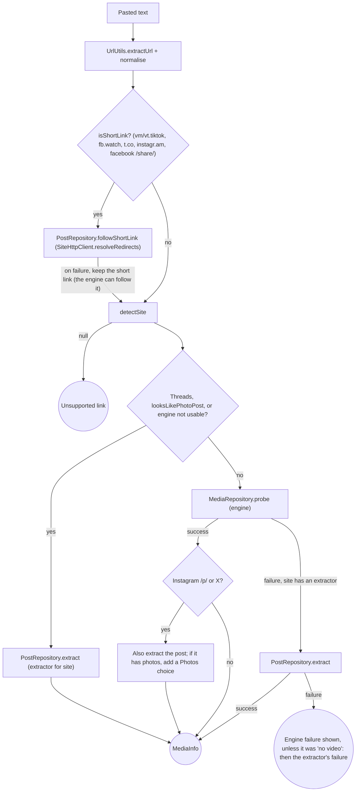

# Photo Extractors

> Status: built (untested against every live site). Files: `lib/data/services/remote/extractors/`, `lib/data/services/remote/site_http_client.dart`, `lib/data/services/remote/media_file_downloader.dart`, `lib/data/repositories/post_repository_impl.dart`.

yt-dlp only extracts video. On an Instagram photo post it fails with `There is no video in this post`. Photos (and Threads, which yt-dlp doesn't support at all) go through small Dart extractors. They're plain HTTP + HTML/JSON parsing, so they work the same on every platform with no native code, and they keep working when the engine failed to start.

## Interface

```dart
abstract interface class PhotoExtractor {
  Site get site;
  bool canHandle(Uri url);
  Future<ExtractedPostDto> extract(Uri url, {String? cookiesPath});
}
```

- `ExtractedPostDto`: `postId`, `media` (each `ExtractedMediaDto`: `url`, `isVideo`, `width`, `height`, `thumbnailUrl` for a video's still), `author`, `caption`, and `musicUrl` (TikTok slideshows).
- `PostMapper.fromDto` turns it into the same `MediaInfo` the preview uses for videos, with `postMedia` filled. The title is the caption's first line (max 100 characters), else `@author`, else the site name. A post that is a single video gets a `previewStream`, so it plays inline in the preview.
- `PhotoExtractors` (`photo_extractors.dart`) holds all five and answers `supports(site)` and `forUrl(url, site)`.
- Extractors throw `ExtractorException(failure, site:, detail:)` with `ExtractorFailure.loginRequired` / `notFound` / `noMedia` / `broken`, or a `DioException`. `PostRepository.extract` wraps them in `ErrorHandler.execute(action: 'extractor.<site>')`; see [Error Handling](../core/error_handling.md#translators) for the messages.
- `ExtractorHtml` (`extractor_html.dart`) holds the shared helpers: `meta` (og: tags), `scriptJson(id)`, `jsonScripts` (every `<script type="application/json">`), `objects` (walks every JSON object depth first), `at(path)`, `widestInSrcset`, `asInt`.

## SiteHttpClient

Every request of the extractors and direct downloads goes through `SiteHttpClient` (dio), never a general HTTP client:

- A normal browser User-Agent (desktop Chrome; `mobile: true` uses iPhone Safari), `Accept-Language: en`.
- Page requests follow redirects **one hop at a time** (max 10). On every hop the `Cookie` header is rebuilt by `CookiesLocalService.cookieHeader(site, url)`, which returns nothing for hosts outside that site. So imported cookies are sent **only** to the site they belong to, even after a redirect.
- `resolveRedirects(url)` follows short links: HEAD first, GET when the host answers HEAD with an error.
- `download(url, path)` uses a second dio for CDN files: it follows redirects itself and **never sends cookies**.
- Nothing logs headers or bodies. `DioErrorTranslator` keeps only host + path.

## Routing a Link

`ResolveLinkUseCase` (`lib/domain/use_cases/resolve_link_use_case.dart`), called by `MediaPreviewNotifier`:



- `useEngine: false` (engine still failed / missing) skips the probe for sites with an extractor; `worksWithoutEngine(site)` tells the preview whether that's possible.
- **Mixed posts** (an Instagram carousel or a tweet with a video and photos) get both: the engine's Video / Audio choices plus a Photos choice (`MediaInfo.withPost`).

## Instagram

`InstagramPhotoExtractor`. Tested 2026-11-25 on a public photo post; worked without login.

1. Get the shortcode from `/p/<code>/`, `/reel/`, `/reels/` or `/tv/` (tracking params are already stripped by `UrlUtils.normalise`).
2. Fetch `https://www.instagram.com/p/<shortcode>/embed/captioned/` (with Instagram cookies only if they're imported).
3. Look for the `shortcode_media` object in the page's scripts (`"contextJSON"` escaped string, or `__additionalDataLoaded(...)`). Carousels: every `edge_sidecar_to_children` slide, in order. Photos take the widest `display_resources` entry; videos take `video_url` with `display_url` as the still.
4. No JSON: take `` and pick the **widest entry in its `srcset`**.
5. Author from `owner.username` (or `.UsernameText`), caption from the first caption edge.

Nothing found (private, removed, or the login wall) → `loginRequired` ("This post needs you to be logged in. Import Instagram cookies in Settings."). There is **no gallery-dl fallback**: it isn't bundled on any platform.

## TikTok Photo Posts (slideshows)

`TikTokPhotoExtractor`, for `/photo/<id>` and `/video/<id>` paths.

1. Short links (`vm.tiktok.com`, `vt.tiktok.com`) are already followed by `ResolveLinkUseCase`.
2. Fetch the post page (with TikTok cookies when imported).
3. Parse `<script id="__UNIVERSAL_DATA_FOR_REHYDRATION__">`. The post is at `__DEFAULT_SCOPE__ → webapp.video-detail → itemInfo → itemStruct` (one constant, `_itemPath`; a missing item with a `statusCode` → `notFound`, else `broken`).
4. Images: `imagePost.images[].imageURL.urlList[]`, the **first URL of each image**, in order, with `imageWidth` / `imageHeight`.
5. Music: `music.playUrl`, used for **Save as video**.

TikTok moves this JSON path now and then. Check it against a live post and update `_itemPath`.

### Save as video

On a TikTok slideshow the preview offers **Save as video** (`DownloadRequest.slideshowVideo`). The repository then also downloads the music, `DownloadMediaUseCase` converts the photos to JPG and asks the engine for one MP4 (`MediaRepository.makeSlideshow`, see [ffmpeg Recipes](../engine/ffmpeg_recipes.md)). The first photo becomes the video's thumbnail and the Library gets one video item.

## Facebook Photos

`FacebookPhotoExtractor` handles any Facebook URL routed to it (`canHandle` is always true): `/photo/?fbid=…`, `/photo.php?fbid=…`, `/<page>/photos/…`, `/share/p/…` (followed first), and posts the engine says have no video.

1. Fetch the page with the desktop User-Agent; if nothing is found, again with the mobile one. A redirect to `/login` stops early.
2. Collect full-size photos from the page's JSON scripts: every `viewer_image` / `photo_image` object (`uri`, `width`, `height`), in order, de-duplicated by path (the same photo appears with different signatures).
3. Nothing in the JSON: `og:image`.
4. Caption from `og:description` / `og:title`; post id from `fbid`, `story_fbid` or the last long number in the path.

Nothing found → `loginRequired` without cookies ("Import Facebook cookies in Settings."), `noMedia` with cookies. **Not yet checked against a live public post.**

## Threads

`ThreadsExtractor`, for `/post/<code>` on `threads.net` or `threads.com`. yt-dlp has no Threads extractor, so this handles both videos and images.

1. Fetch the post HTML.
2. Find the post object in the embedded JSON scripts: the object whose `code` matches and that has `image_versions2`, `carousel_media` or `video_versions`.
3. Each item (or each `carousel_media` entry): a video from the first `video_versions` URL (with the widest image candidate as its still), else the widest `image_versions2.candidates` image.
4. No JSON: `og:video`, or `og:image` when the post was found.

Expect this to break when Meta changes the page. It's one isolated file.

## X Images

`XImageExtractor`, for `/status/<id>` links. It doesn't scrape x.com: it reads X's public **syndication endpoint**, `https://cdn.syndication.twimg.com/tweet-result?id=<id>&lang=en&token=a` (the token is required but any value works; checked 2026-11-25). The host is on twimg.com, so no X cookies go along.

- A tombstone or missing `id_str` → `notFound`.
- `mediaDetails[]`: photos use `media_url_https` rewritten to `pbs.twimg.com/media/<id>?format=<ext>&name=orig` (full size); videos and GIFs use the highest-bitrate `video/mp4` variant, with the photo URL as the still.
- Author `user.screen_name`, caption `text`.

For a tweet with a video, the engine probe wins and the extractor only adds a Photos choice when the tweet also has photos.

## Downloading the Images

A request whose `isPost` is true skips the engine. `PostRepositoryImpl.download` uses `MediaFileDownloader`:

1. Each chosen item is downloaded in order to `work/<jobId>/01.<ext>`, `02.<ext>`, … with a `Referer` of the site's home page. The extension comes from the response's `Content-Type` (CDN URLs often have none), else the URL, else `jpg` / `mp4`.
2. Progress is reported across all items (index + the current file's fraction), at most every 250 ms, with an average speed.
3. A video's still is downloaded next to it (best-effort) for its thumbnail.
4. Cancel uses a dio `CancelToken` per job; a cancelled job ends as `DownloadCancelled`.

Then `DownloadMediaUseCase`:

- **Direct videos skip ffmpeg:** Threads, Instagram carousel and X videos come as MP4 from the CDN and go to the Library as downloaded (no remux, no iPhone re-encode).
- **Photos to JPG** (Settings → "Convert photos to JPG", on by default): every non-JPG photo (WebP, HEIC, PNG…) is re-encoded with `ImageService.toJpg` (`flutter_image_compress`, quality 92; the bundled ffmpeg on Windows and Linux). Videos are left alone.
- `LibraryRepository.addPost` names each file with `FilenameUtils.forPostItem` (`<user> <postid> 01.jpg`, …), makes a thumbnail for each photo, and adds one Library row per item. Items of a multi-item post share a `groupId` (with `groupIndex` for their order), so the Library shows them as one group.

## When an extractor breaks

Each extractor is one isolated file. Paste a known public post in a debug build, read the failure in Settings → About → Error log (the `detail` of `ExtractorException` says which step found nothing), compare the live page with what the parser expects, and update the parser.
