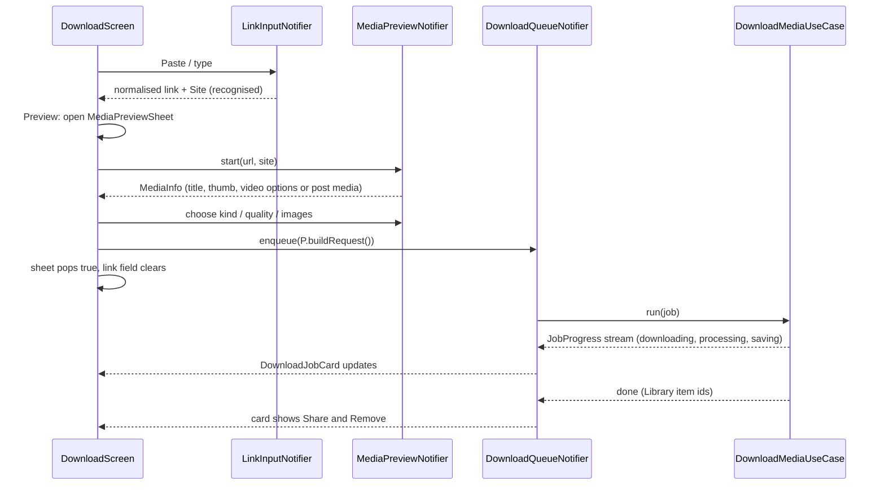

# Download

> Status: built (v1 steps 1–2), not yet tested on every device. Feature folder: `lib/ui/features/download/`.

Paste a link → Preview → choose Video / Audio / Photos and quality → download into the app's folder → the finished card offers Share and Remove.

## Screens and Widgets

```text
download/
  providers/
    link_input/       link_input_notifier.dart       # field text, cleaned URL, detected site
    media_preview/    media_preview_notifier.dart    # resolve link + choices (autoDispose)
    download_queue/   download_queue_notifier.dart   # all jobs, progress, cancel/retry/share/remove (keep-alive)
    engine_status/    engine_status_notifier.dart    # engine init + yt-dlp update (keep-alive)
  views/
    download/
      download_screen.dart
      widgets/ supported_sites_row.dart, link_status_panel.dart, download_jobs_section.dart, download_job_card.dart
    preview/                        # a bottom sheet (showAppBottomSheet), not a route
      media_preview_sheet.dart
      widgets/ preview_header.dart, preview_media.dart, preview_loading.dart, video_quality_chips.dart,
               audio_quality_chips.dart, photo_selection_grid.dart, reencode_hint.dart
```

The screen is a `ScreenScrollView`: header, `SupportedSitesRow`, `LinkField`, `LinkStatusPanel` (what the link is + **Preview**), then the job sections, or an empty state when there are no jobs.

## Providers

| Provider | Owns | Key methods |
| --- | --- | --- |
| `linkInputProvider` (`LinkInputNotifier`) | The field's text, the normalised URL, the detected `Site`, `LinkStatus` (empty / notALink / unsupported / recognised) | `pasteFromClipboard()`, `onChanged()`, `clear()` |
| `mediaPreviewProvider` (`MediaPreviewNotifier`, `.autoDispose`) | Preview status (incl. `waitingForEngine`), `MediaInfo`, chosen kind, video option, audio quality, iPhone toggle, selected images, slideshow switch | `start(url, site)`, `retry()`, `selectKind()`, `selectOption()`, `selectAudioQuality()`, `setIphoneCompatible()`, `toggleImage()`, `toggleSelectAll()`, `setSlideshowVideo()`, `buildRequest()` |
| `downloadQueueProvider` (`DownloadQueueNotifier`, keep-alive) | All jobs (loaded from the database) + live progress per job | `enqueue(request)`, `cancel(id)`, `retry(id)`, `dismiss(id)`, `clearFinished()`, `share(id)`, `remove(id)` |
| `engineStatusProvider` (`EngineStatusNotifier`, keep-alive) | Engine init status, `EngineInfo`, update check / update status | `retry()`, `checkForUpdate()`, `update()` (see [Settings](settings.md#engine)) |

- The Download screen watches `engineStatusProvider` so the engine starts after the first frame and is ready by Preview (see [App Startup](../architecture/app_startup.md#engine-init-runs-after-the-first-frame)).
- `MediaPreviewNotifier` resolves the link through `ResolveLinkUseCase` (engine probe or a photo extractor, see [Photo Extractors](../extractors/photo_extractors.md)). While the engine is initialising it shows "waiting for engine"; if the engine failed, photo posts and Threads still resolve without it (`worksWithoutEngine`), anything else shows the engine error with **Retry**.

## Flow



## Preview

`MediaPreviewSheet` builds its own `AppBottomSheet` (`ownLayout: true`) so its **Download** button is pinned with `bottomAction` under the scrolling content.

- `PreviewHeader`: thumbnail, title, uploader, site badge, duration.
- **Video preview:** `PreviewMedia` shows ▶ when the probe found a direct stream (`MediaInfo.previewStream`) and plays it inline with `video_player` (with the stream's HTTP headers). Without one, only the thumbnail shows.
- **Kind picker** (`SegmentedPicker`, only when there's more than one): Video, Audio (when the media has both), Photos (post media). The initial kind is Video, else Photos, else Audio.
- **Video:** `VideoQualityChips` with the options that exist and their size estimates; the default is the highest option at or below Settings' default quality, else Best. Then the **iPhone-compatible** switch (default from Settings) and `ReencodeHint` when the chosen option needs a re-encode.
- **Audio:** `AudioQualityChips` (320 / 192 / 128 kbps, default from Settings).
- **Photos:** `PhotoSelectionGrid` with every item selected, tap to toggle, Select all / none. A TikTok slideshow (with music) adds a **Save as video** switch.
- The pinned button reads "Download · 310 MB" (size when known), or "Download 6 photos" ("Download 6 items" when the post mixes photos and videos) for a post; it's disabled with nothing selected.

## Job Card

`DownloadJobCard` wraps the base `JobCard`:

| Stage | Shows | Actions |
| --- | --- | --- |
| `queued` | "Waiting…" | Cancel |
| `downloading` | Gradient bar, percent, speed, quality, ETA | Cancel |
| `processing` | Bar + step: Merging / Extracting audio / Converting for iPhone / Converting photos / Making slideshow / Finishing | Cancel |
| `saving` | Indeterminate bar | — |
| `done` | Quality (e.g. "1080p MP4", "MP3 320 kbps", "6 photos"), size | **Share**, **Remove**; tap → `MediaViewerRoute` on the job's Library items |
| `failed` | The failure's catalog text | **Dismiss**, the failure's own fix, **Retry** |
| `cancelled` | Quality | **Dismiss**, **Retry** |

The failure's own fix, chosen from its message:

| Failure | Extra action |
| --- | --- |
| `EngineMessages.extractorBroken` (site changed) | **Update engine** → `EngineStatusNotifier.update()` |
| `EngineMessages.needsLogin`, `EngineMessages.botCheck` | **Import cookies** → `CookiesRoute` |

Sections (`DownloadJobsSection`): **In progress** (queued, downloading, processing, saving) and **Finished** (done, failed, cancelled) with **Clear finished**. Dismiss and Clear finished remove cards only, never files.

### Share and Remove

- **Share** opens the system share sheet with the job's Library file(s) (all items of a post together). It never deletes anything and isn't followed by a "remove?" prompt, because the share sheet can't reliably tell the app whether the file was saved.
- **Remove** asks first (`ConfirmDialog`, destructive). On confirm, `LibraryRepository.remove` deletes the files, thumbnails and Library rows, then the card goes.

The Library's **Save to Photos / Save to Files** with the "remove from app?" prompt is described in [Library](library.md#save-and-the-remove-prompt).

## Queue and Concurrency

- `DownloadQueueNotifier` runs at most **2** jobs at once; the rest wait as `queued` (oldest first).
- ffmpeg work (iPhone re-encode, slideshow, conversions) goes through the shared `FfmpegSlot`, so only one ffmpeg job runs at a time across downloads and the converter (see [Media Engine](../engine/media_engine.md#concurrency)).
- Jobs are saved to the `download_job` table on every stage change (not every percent), so the list survives a restart. Jobs that were queued or running when the app was killed come back as failed ("interrupted") with Retry; swiping the app away stops Dart-side tracking.

## Running in the Background (Android)

`DownloadQueueNotifier` keeps `BackgroundWorkRepository` in step with the queue (`listenSelf`): while anything is queued or running, Android runs `DownloadService`, a `dataSync` foreground service whose notification shows the oldest running job's title and percent (indeterminate when unknown) and a **Cancel** action. Cancel comes back through Pigeon (`BackgroundWorkFlutterApi.cancelRequested`) to `cancel(id)`. The service stops when the queue is empty. `POST_NOTIFICATIONS` is requested on the first enqueue (Android 13+); downloads run even if it's denied.

Pigeon input: `lib/config/pigeon/background_work_api.dart` (Kotlin in `android/.../background/`). iOS and macOS use `NoopBackgroundWorkService`. See [Android Engine](../engine/android_engine.md#running-in-the-background).

## DownloadMediaUseCase

`DownloadMediaUseCase.run(job)` streams `JobProgress`; the last one is done, failed or cancelled. `work/<jobId>/` is always cleared at the end.

1. **Video / audio** (`MediaRepository.download`, yt-dlp): downloading → processing steps → finished file + thumbnail.
2. If it's a video with iPhone-compatible on and the chosen option needs it, `MediaRepository.convertForIphone` re-encodes (`convertingForIphone`).
3. **Posts** (photos / carousel videos / Threads, `PostRepository.download`, direct HTTP): downloads every chosen item, then, with "Convert photos to JPG" on, converts them (`convertingPhotos`). A TikTok slideshow with **Save as video** becomes one MP4 with the music instead (`makingSlideshow`).
4. `saving`: `LibraryRepository.addDownload` / `addPost` moves the files into `downloads/` and inserts the Library rows (a post's items share a `groupId`).
5. `done` with the Library item ids and total size; on any failure `failed` with the catalog message.
