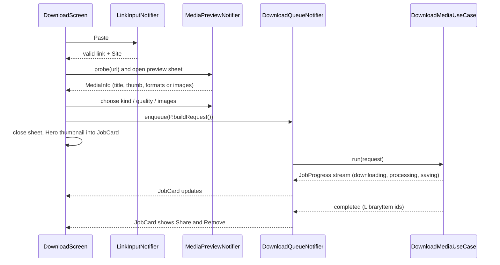

# Download

> Status: planned (v1 step 1). Feature folder: `lib/ui/features/download/`.

Paste a link → preview → choose Video / Audio / Photos and quality → download into the app's folder → the finished card offers Share and Remove.

## Screens and Widgets

```text
download/
  providers/
    link_input_notifier.dart        # clipboard, validation, detected site
    media_preview_notifier.dart     # probe + selections (autoDispose)
    download_queue_notifier.dart    # all jobs, progress, cancel/retry/share/remove (keep-alive)
  views/
    download/
      download_screen.dart
      widgets/ download_header.dart, site_badges_row.dart, job_section.dart, empty_queue.dart
    preview/                        # shown as a bottom sheet / side panel, not a route
      media_preview_sheet.dart
      widgets/ preview_media.dart, format_picker.dart, quality_chips.dart, photo_selection_grid.dart, iphone_toggle.dart, download_button.dart
  widgets/
    job_card.dart, job_actions.dart
```

## Providers

| Provider | Owns | Key methods |
| --- | --- | --- |
| `linkInputProvider` (`LinkInputNotifier`) | The field's text, the detected `Site`, validity | `pasteFromClipboard()`, `onChanged()`, `clear()` |
| `mediaPreviewProvider` (`MediaPreviewNotifier`, `.autoDispose`) | Probe status, `MediaInfo`, chosen kind (video/audio/photos), quality, iPhone toggle, selected image indexes | `probe(url)`, `selectKind()`, `selectQuality()`, `toggleImage()`, `selectAll()`, `buildRequest()` |
| `downloadQueueProvider` (`DownloadQueueNotifier`, keep-alive) | All jobs from the database + live progress per job | `enqueue(request)`, `cancel(id)`, `retry(id)`, `share(id)`, `remove(id)`, `clearFinished()` |

`MediaPreviewNotifier` waits for `EngineStatusNotifier` to be `ready` before probing (see [App Startup](../architecture/app_startup.md#engine-init-runs-after-the-first-frame)).

## Flow



## Preview

- Shows thumbnail, title (2 lines), uploader, site badge, duration.
- **Video preview:** tap ▶ to play inline with `video_player` when the probe found a direct stream (see [Media Engine: Probe](../engine/media_engine.md#probe)). Otherwise the thumbnail stays and the ▶ isn't shown.
- **Kind picker:** Video / Audio / Photos. Only kinds that exist are shown (a photo post shows Photos only; a video shows Video and Audio).
- **Quality chips:** Best, 4K, 1440p, 1080p, 720p, 480p for video (only heights that exist), each with its estimated size; 320 / 192 / 128 kbps for audio. Default comes from Settings.
- **iPhone-compatible** toggle (default from Settings, on). A chip that needs a re-encode shows a small "converts" hint.
- **Photos:** `PhotoSelectionGrid` with all images selected, tap to toggle, "Select all / none". For TikTok slideshows, an extra **Save as video** switch.
- The Download button shows what you'll get: "Download · 310 MB" or "Download 6 photos".
- If the same URL + kind + quality is already in the Library, the button reads "Download again" and a hint links to the existing item.

## Job Card

| Stage | Shows | Actions |
| --- | --- | --- |
| `queued` | "Waiting…" | Cancel |
| `downloading` | Gradient bar, percent, speed, ETA | Cancel |
| `processing` | Indeterminate bar + "Converting for iPhone" / "Merging" / "Converting to MP3" | Cancel |
| `saving` | Indeterminate bar | — |
| `completed` | ✓, format, quality, size | **Share**, **Remove**, tap → opens the item in the Library viewer |
| `failed` | Error text from the catalog | **Retry**, **Dismiss**, plus the failure's own action (e.g. **Open Settings** for cookies, **Update engine**) |
| `cancelled` | "Cancelled" | **Retry**, **Dismiss** |

Sections: **In progress** (queued, downloading, processing, saving) and **Finished** (completed, failed, cancelled), newest first. **Clear finished** removes cards only, never files.

### Share and Remove

- **Share** opens the system share sheet with the job's file(s) (all photos of a carousel together). It never deletes anything and isn't followed by a "remove?" prompt, because the share sheet can't reliably tell the app whether the file was actually saved.
- **Remove** asks first (`ConfirmDialog`, destructive): "Remove from app? The file will be deleted from the app. Copies you saved to Photos or Files stay." On confirm: delete the file(s) + thumbnails, delete the Library rows, remove the card.

The Library's **Save to Photos / Save to Files** with the automatic "remove from app?" prompt is described in [Library](library.md#save-and-the-remove-prompt).

## DownloadMediaUseCase

1. Create the job row (`queued`).
2. Wait for a slot (max 2 downloads at once, 1 ffmpeg job).
3. **Video/audio:** `MediaEngine.download(YtDlpArgsBuilder.build(request))`. **Photos / Threads:** `MediaFileDownloader`.
4. Post-process if needed (iPhone re-encode, WebP → JPG, slideshow → video).
5. Rename with `FilenameUtils`, move to `downloads/`, make thumbnails.
6. Insert Library rows; mark the job `completed` with their ids.
7. On any failure: mark `failed` with the failure type, delete `work/<jobId>/`.

Every step reports a `JobProgress` stage. The notifier persists stage changes (not every percent) to the job row, so the list survives an app restart.
