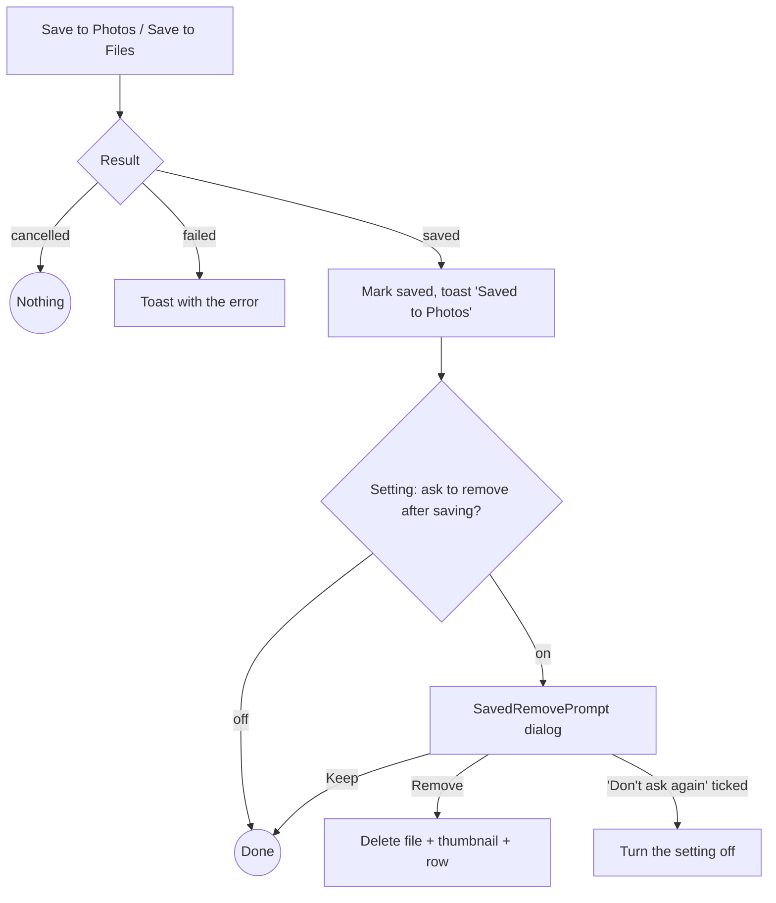

# Library

> Status: planned (v1 step 1). Feature folder: `lib/ui/features/library/`.

Everything the app downloads or converts lands in its own folder first. The Library is the one place to see all of it and to move things out to Photos or Files.

## Screens and Widgets

```text
library/
  models/
    library_filter.dart            # kind, sites, query, sort
  providers/
    library_notifier.dart          # filtered items (stream), filter state
    library_actions_notifier.dart  # save to Photos / Files, share, delete, remove prompt
    media_viewer_notifier.dart     # current item, swipe list (autoDispose)
  views/
    library/
      library_screen.dart
      widgets/ library_filter_bar.dart, library_grid.dart, library_search_field.dart, sort_menu.dart, storage_summary.dart
    media_viewer/
      media_viewer_screen.dart
      widgets/ video_viewer.dart, audio_viewer.dart, photo_viewer.dart, viewer_action_bar.dart
  widgets/
    item_action_sheet.dart
```

## Providers

| Provider | Owns | Key methods |
| --- | --- | --- |
| `libraryProvider` (`LibraryNotifier`, keep-alive) | `LibraryFilter` + the live list from `LibraryRepository.watchItems(filter)` | `setKind()`, `toggleSite()`, `search()`, `setSort()` |
| `libraryActionsProvider` (`LibraryActionsNotifier`) | In-flight action per item, and `pendingRemovePrompt` (the item just saved) | `saveToPhotos(id)`, `saveToFiles(id)`, `share(id)`, `delete(id)`, `confirmRemoveAfterSave(id, {dontAskAgain})`, `dismissRemovePrompt()` |
| `mediaViewerProvider` (`MediaViewerNotifier`, `.autoDispose`) | The open item and the ids around it | `open(id, ids)`, `next()`, `previous()` |

## Grid

- Filter chips: **All · Videos · Audio · Photos**, then one chip per site that has items.
- Search by title or uploader. Sort: Newest (default), Oldest, Largest.
- Carousel photos are grouped: one card with a stack icon and count; opening it pages through the group.
- Cards show thumbnail, title, site badge, duration or dimensions, size, and a ✓ if saved to Photos or Files.
- Empty state: "Nothing here yet. Paste a link on the Download tab." + **Go to Download**.
- A `StorageSummary` line at the top: "42 items · 3.1 GB".

## Item Actions

Long-press a card (right-click on macOS), or use the viewer's action bar:

| Action | Does |
| --- | --- |
| **Save to Photos** | `GalleryService` → Photos / gallery. Sets `savedToPhotosAt`. |
| **Save to Files** | `FileExportService` → Files app / SAF / save panel. Sets `savedToFilesAt`. |
| **Share** | System share sheet. No prompt afterwards. |
| **Convert** | Opens Convert with this item as input. |
| **Show in Finder** | macOS only. |
| **Delete** | `ConfirmDialog`, then delete file + thumbnail + row. |

Multi-select (tap **Select** in the app bar) allows Save to Photos, Share and Delete on many items at once.

## Save and the Remove Prompt



- The prompt only follows a **confirmed** save (Save to Photos / Save to Files return saved / cancelled / failed). It never follows Share.
- Dialog text: "Saved to Photos. Remove it from the app to free up space?" with **Keep** and **Remove**, and a "Don't ask again" checkbox. The setting can be turned back on in Settings → Storage.
- The notifier sets `pendingRemovePrompt`; the View shows the dialog (`ref.listen`) and calls back `confirmRemoveAfterSave` or `dismissRemovePrompt`. The notifier never opens dialogs itself.

## Viewer

- **Video:** full-screen `video_player` with scrubber, play/pause, mute; swipe left/right for the next item.
- **Audio:** cover art (or gradient + icon), scrubber, play/pause.
- **Photo:** zoomable pager.
- Action bar: Save to Photos, Save to Files, Share, Convert, Delete, and an info sheet (source URL with **Open link**, size, resolution, codec, date).
