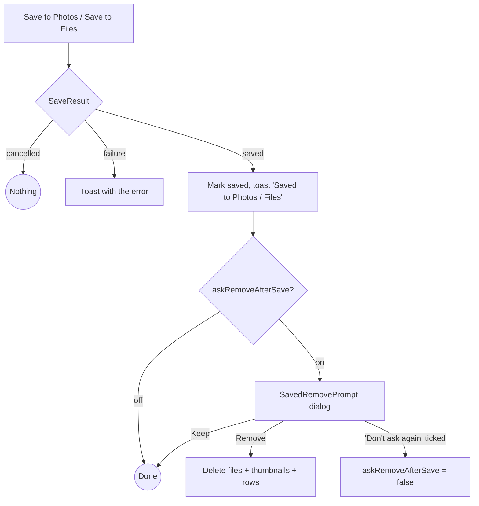

# Library

> Status: built (v1 steps 1–2, plus the post page and PDFs), not yet tested on every device. Feature folder: `lib/ui/features/library/`.

Everything the app downloads, converts or makes with a [tool](tools.md) lands in its own folder first. The Library is the one place to see all of it and to move things out to Photos or Files.

## Screens and Widgets

```text
library/
  models/
    library_entry.dart             # LibraryItem + absolute file/thumbnail paths, canSaveToPhotos, groupIds
    library_filter.dart            # kind, sites, query, sort
    library_kind_filter.dart, library_sort.dart
  providers/
    library/library_notifier.dart                 # live list, filter, multi-select (keep-alive)
    library_actions/library_actions_notifier.dart # save to Photos / Files, share, delete, remove prompt
    media_viewer/media_viewer_notifier.dart       # open item + swipe list (autoDispose)
  views/
    library/
      library_screen.dart
      widgets/ storage_summary.dart, library_toolbar.dart, library_search_field.dart, sort_menu.dart,
               library_filter_bar.dart, selection_bar.dart, library_grid.dart, library_loading_grid.dart
    library_post/                  # LibraryPostRoute (/library/post): one grouped post
      library_post_screen.dart
      widgets/ post_header.dart, post_actions.dart, post_item_grid.dart
    media_viewer/                  # MediaViewerRoute (/viewer), full screen above the tabs
      media_viewer_screen.dart
      widgets/ video_viewer.dart, audio_viewer.dart, photo_viewer.dart, document_viewer.dart,
               player_controls.dart, viewer_action_bar.dart, item_info_sheet.dart
  widgets/
    item_action_sheet.dart         # showItemActionSheet + confirmAndDelete
    library_actions_listener.dart  # toasts + the remove prompt for the visible route
    library_picker_sheet.dart      # a Library grid in a sheet to pick inputs (Convert, Tools)
```

## Providers

| Provider | Owns | Key methods |
| --- | --- | --- |
| `libraryProvider` (`LibraryNotifier`, keep-alive) | Every item from `LibraryRepository.watchItems()` (unfiltered), the `LibraryFilter`, multi-select | `setKind()`, `toggleSite()`, `search()`, `setSort()`, `startSelecting()`, `stopSelecting()`, `toggleSelected()`, `toggleSelectedAll(ids)`, `toggleSelectAll()` |
| `libraryActionsProvider` (`LibraryActionsNotifier`) | Busy item ids, and `pendingRemovePrompt` (the items just saved + destination) | `saveToPhotos(ids)`, `saveToFiles(id)`, `share(ids)`, `delete(ids)`, `confirmRemoveAfterSave({dontAskAgain})`, `dismissRemovePrompt({dontAskAgain})` |
| `mediaViewerProvider` (`MediaViewerNotifier`, `.autoDispose`) | The ids the viewer pages through and the current index | `open(id, ids)`, `show(index)`, `next()`, `previous()`, `retain(existingIds)` |

The repository streams every row; filtering, sorting and grouping happen in `LibraryState` (`visibleItems`, `visible`, and `group(groupId)`: one post's items by `groupIndex`, ignoring the filter).

## Grid

- Top: `StorageSummary` ("42 items · 3.1 GB"), `LibraryToolbar` (search by title or uploader, `SortMenu`: Newest / Oldest / Largest, **Select** / **Done**), then `LibraryFilterBar`: **All · Videos · Audio · Photos · PDFs** and one chip per site that has items.
- **Posts are grouped:** items of one post (a carousel download, or a tool's several outputs such as PDF → images or Split) share a `groupId`; the grid shows one card (the first by `groupIndex`) with a count badge. Tapping it opens the [post page](#post-page); its action sheet applies to every item.
- `MediaCard` shows thumbnail, title, site badge, duration, size · format, and a ✓ when saved to Photos or Files (`isSaved`).
- Tap opens `MediaViewerRoute`, which swipes through the visible single items (grouped posts are left out: they open their own page), or toggles selection while selecting. Long-press / right-click (the card's "more") opens the item's action sheet.
- States: loading grid (shimmer), error, empty ("Go to Download" switches to the Download tab), and "no matches" when the filter hides everything.

## Item Actions

From the action sheet (`showItemActionSheet`):

| Action | Does |
| --- | --- |
| **Save to Photos** | `GalleryService` (`gal`) → Photos / gallery / the Windows Pictures library; on Linux a copy into `MediaTool/` in the Pictures or Videos folder. Sets `savedToPhotosAt`. Not offered for audio or PDFs (`GalleryService.supports` is true only for video and photo). |
| **Save to Files** | `FileExportService` → Android SAF create-document, iOS document picker (export), the desktop save dialog on macOS, Windows and Linux (`file_picker` `saveFile`, then a file copy; Linux needs the desktop portal, `zenity` or `kdialog`). Sets `savedToFilesAt`. Single items only (not on a grouped card: open the post to save one file). |
| **Share** | System share sheet (`share_plus`). No prompt afterwards. |
| **Convert** | `ConvertSourceNotifier.pickFromLibrary(id)`, then pushes `ConvertRoute` (the Convert & Compress screen, above the tabs). Single items only; not for PDFs. |
| **Delete** | `confirmAndDelete` (`ConfirmDialog`), then delete files + thumbnails + rows. |

**Multi-select:** `SelectionBar` shows the count, **Select all / none**, and Save to Photos (skips audio and PDFs), Share and Delete for the selected items. Tapping a grouped card selects all its items.

## Post Page

`LibraryPostRoute(groupId)` (`/library/post`) opens full screen above the tabs when a grouped card is tapped, and from a tool's **Open** when it made several files.

- `PostHeader`: the first item's title, site badge and uploader, then "N items · size" and the date added.
- `PostActions` (a wrapping `ChipRow` of `TonalButton`s): **Save all to Photos** (only the items that can go there), **Share all**, **Delete all** (with `confirmAndDelete`). Save to Files asks for a destination per file, so it stays per item (open an item, or use its action sheet).
- `PostItemGrid`: every item as a `MediaCard` in the post's order. Tap opens the viewer paging through just this post; long-press / right-click opens that item's action sheet.
- The page follows `libraryProvider.group(groupId)`: deleted items drop out, and the page pops once the group is empty. It's wrapped in `LibraryActionsListener`, so saves show toasts and the remove prompt here too.

## Save and the Remove Prompt



- The prompt only follows a **confirmed** save (`SaveResult.saved`). It never follows Share.
- `SavedRemovePrompt` asks whether to remove the saved item from the app, with **Keep** / **Remove** and a "Don't ask again" checkbox. The setting can be turned back on in Settings → Library & storage.
- The notifier sets `pendingRemovePrompt`; `LibraryActionsListener` (wrapping both the Library screen and the viewer, reacting only on the visible route) shows the toasts and the dialog, then calls `confirmRemoveAfterSave` or `dismissRemovePrompt`. The notifier never opens dialogs itself.

## Viewer

`MediaViewerRoute(initialId, ids)` opens full screen above the tabs, from the grid or from a finished download's card. It's a `PageView` over `ids`: swipe for the next item; deleted items drop out (`retain`) and the viewer closes when none are left.

- **Video:** `video_player` on the local file (`video_player_win` on Windows), tap to play/pause, `PlayerControls` (scrubber, play/pause); pauses when swiped away. Linux has no `video_player` implementation, so the viewer shows "This file can't be played here" and Share / Save still work.
- **Audio:** cover art (or the Aurora gradient with a note), title, `PlayerControls`.
- **Photo:** zoomable (`InteractiveViewer`), Hero from the grid card; a broken-image icon when the file is missing (removed outside the app).
- **PDF:** `DocumentViewer` (`PdfViewer.file` from pdfrx: scroll and zoom through the pages); an error banner (`LibraryMessages.cantOpenPdf`) when it can't be opened.
- `ViewerActionBar`: Save to Photos (not for audio or PDFs), Save to Files, Share, **Info** (`ItemInfoSheet`: file name, size, format, duration, date added, source URL as selectable text), Delete.

Not built yet: Convert from the viewer, Show in Finder, and an "Open link" button.
