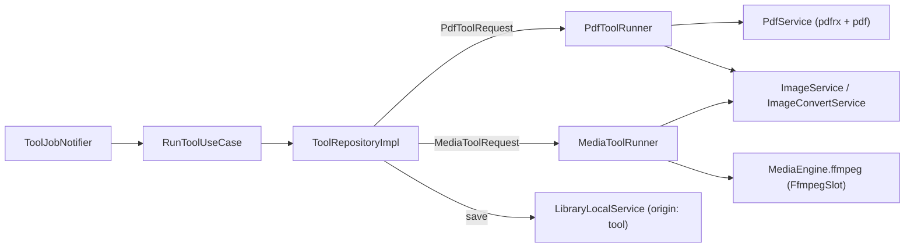

# Tools

> Status: built, not yet tested on devices. Feature folder: `lib/ui/features/tools/`.

The Tools tab (tab 3) is a hub of small one-job tools that run on the device: PDF tools, GIF and video tools, and image tools. Its first card opens the existing [Convert & Compress](convert.md) screen. Every result goes into the [Library](library.md); nothing leaves the device.

## Table of Contents

- [Hub](#hub)
- [Tools](#tools)
- [Tool Screen](#tool-screen)
- [Providers](#providers)
- [Data Layer](#data-layer)
- [PDF Tools](#pdf-tools)
- [GIF, Video and Image Tools](#gif-video-and-image-tools)
- [Saving Results](#saving-results)
- [Limits](#limits)
- [Not Built](#not-built)

## Hub

`ToolsScreen` (`ToolsRoute`, tab `tools`) shows:

1. A **Convert & compress** card (`SourceTile`), which pushes `ConvertRoute` (`/tools/convert`).
2. One `ToolSection` for each `ToolCategory` (**PDF**, **GIF & video**, **Image**), each a list of tool cards. Tapping a card pushes `ToolRoute(tool:)` (`/tools/tool`).

```text
tools/
  hooks/
    use_preview_player.dart  # video_player for the picked video (Trim, Video to GIF); failed on Linux
  models/
    tool.dart              # enum Tool: category, icon, title, body, input, startLabel, multiple, minSources
    tool_category.dart     # pdf, gifVideo, image (hub sections, in order)
    split_mode.dart        # each, every N pages, ranges
    crop_aspect.dart       # original, 1:1, 4:5, 3:2, 16:9, 9:16
  providers/
    tool_sources/  tool_sources_notifier.dart   # picked files (+ page thumbnails for Organize)
    tool_options/  tool_options_notifier.dart   # every option + the ToolRequest (or the problem)
    tool_job/      tool_job_notifier.dart       # running job + result items
  views/
    tools/
      tools_screen.dart
      widgets/ tool_section.dart
    tool/
      tool_screen.dart
      widgets/ tool_source_tiles.dart, tool_library_picker.dart, tool_source_list.dart, source_row.dart,
               tool_options.dart (switch over the tool), choice_section.dart, option_note.dart,
               images_to_pdf_options.dart, pdf_to_images_options.dart, split_pdf_options.dart,
               organize_pages_options.dart, page_tile.dart, compress_pdf_options.dart, unlock_pdf_options.dart,
               video_part_options.dart, trim_video_options.dart, video_preview.dart, clip_timeline.dart,
               clip_row.dart, clip_editor.dart, images_to_gif_options.dart, resize_image_options.dart,
               edit_image_options.dart, edit_preview.dart,
               tool_start_button.dart, tool_job_panel.dart, tool_result_section.dart, tool_result_actions.dart
```

## Tools

`Tool` (enum) describes each card. `input` (`ToolInput`, in `lib/domain/models/`) decides the picker filters and which Library items are offered.

| Tool | Input | Files | Options | Output |
| --- | --- | --- | --- | --- |
| **Images to PDF** | images | 1+ in order | Page size A4 / Letter / Fit image; orientation Auto / Portrait / Landscape (Auto turns each page to match its image); margin None / Small (18 pt) / Large (36 pt) | One PDF, one page per image |
| **PDF to images** | PDF | 1 | JPG / PNG; sharpness Screen 96 / Standard 150 / Print 300 dpi | One image per page (grouped) |
| **Merge PDFs** | PDF | 2+ in order | — | One PDF |
| **Split PDF** | PDF | 1 | Every page / every N pages / ranges (`1-3, 5, 8-10`); a note says how many PDFs it will make | One PDF per part (grouped) |
| **Organize pages** | PDF | 1 | A grid of pages: press and hold a page, then drop it on another to move it; rotate or delete each page; Reset | One PDF |
| **Compress PDF** | PDF | 1 | Light (150 dpi, q80) / Medium (120 dpi, q65) / Strong (96 dpi, q50). A note says text can't be selected afterwards. | One PDF |
| **Unlock PDF** | PDF | 1 | Password (needed only when the PDF asks for one to open) | One PDF without its password and restrictions |
| **Video to GIF** | video | 1 | Part of the video, picked on the [preview player](#video-preview) (the first 5 s by default); 10 / 12 / 15 / 20 / 24 fps; width 320 / 480 / 640 / 800 px | One GIF |
| **Images to GIF** | images | 2+ in order | Seconds per image (0.25 / 0.5 / 1 / 2 / 3); width 320–800 px. Every frame takes the first image's shape (white bars around others). | One GIF |
| **GIF to video** | GIF | 1 | — | One MP4 |
| **Trim video** | video | 1 | **Keep clips** / **Remove clips**; one or more clips picked on the [preview player](#video-preview); with several kept clips, **Save as** One video / Separate videos; **Frame-exact cut** switch when nothing is joined | One video, or one per clip (grouped) |
| **Mute video** | video | 1 | — | The video without sound (streams copied) |
| **Resize image** | images | 1 | 25 / 50 / 75 / 150 / 200 / 300 / 400 %, shows the new pixel size (long side capped at 8000 px); JPG / PNG. Enlarged images get Lanczos plus a light sharpen. Default: 50 % when the long side is ≥ 2400 px, else 200 %. | One image |
| **Rotate & crop** | images | 1 | Rotate left / right, flip horizontal / vertical, crop presets (Original, 1:1, 4:5, 3:2, 16:9, 9:16, centred); a live preview (`EditPreview`) shades the cropped part; JPG / PNG | One image |

Input types (`ToolInput.extensions`):

| Input | Extensions | From Photos |
| --- | --- | --- |
| `images` | jpg, jpeg, png, webp, heic, heif, bmp | Yes |
| `video` | mp4, mov, m4v, mkv, webm, avi, 3gp | Yes |
| `pdf` | pdf | No (Photos can't hold PDFs) |
| `gif` | gif | No (Photos usually turns GIFs into stills) |

## Tool Screen

`ToolScreen(tool:)` is one `ScreenScrollView` with a back button and the tool's title and description. Its steps:

1. **Pick.** `ToolSourceTiles` offers:
   - **From Library**: `LibraryPickerSheet` (`lib/ui/features/library/widgets/`), limited to the input's kinds and formats. It allows several picks when the tool takes several files.
   - **From Photos** (images and video tools only).
   - **From Files**: the system picker limited to the input's extensions.

   Picked files are copied into `work/source-<uuid>/` and read. Library files are read in place. Files of the wrong type are skipped; the pick fails only when none could be read.
2. **Arrange and choose.**
   - `ToolSourceList` shows the picks as `SourceRow`s. Tools that take several files can reorder them (`ReorderableListView`, `onReorderItem`), remove one, add more, or **Clear all**. Single-file tools have a close (✕) button that clears the pick.
   - `ToolOptions` then shows the tool's own options.
   - `OptionNote` shows a problem the user can fix: a locked PDF, bad ranges, a part too short, no pages left, or nothing changed.
3. **Run.** The pinned `ToolStartButton` shows the tool's label ("Make PDF", "Merge", "Make GIF"…) and is enabled only when the options make a request. `ToolJobPanel` then shows a `JobCard` with "Waiting for another conversion to finish…" (ffmpeg tools wait for the slot), percent, ETA and **Cancel**. After a failure or a cancel it shows **Try again**.
4. **Result.** `ToolResultSection` shows the result thumbnails (up to a few), the file count, and the size before → after (all sources → all results). A toast says "Done and added to your Library". The pinned `ToolResultActions` has:
   - **Open**: the viewer for one item, or the [post page](library.md#post-page) for several;
   - **Share**: every result;
   - **Done**: forgets the job and the picks.

## Providers

All three are `NotifierProvider.family` over `Tool`. They are keep-alive, so each tool keeps its own picks, options and job when you leave the screen, and a job keeps running.

| Provider | Owns | Key methods |
| --- | --- | --- |
| `toolSourcesProvider(tool)` (`ToolSourcesNotifier`) | The picked `LocalMediaInfo`s in order; page thumbnails for Organize | `pick(PickSource)`, `pickFromLibrary(ids)`, `remove(index)`, `reorder(from, to)`, `clear()` |
| `toolOptionsProvider(tool)` (`ToolOptionsNotifier`) | `ToolOptionsState`: every tool's options, the `ToolRequest` (or `problem`), Split's `partCount` | `change(edit)`, `setRange(start, end)`, `setRangeStart(s)`, `setRangeEnd(s)`, `setTrimMode(mode)`, `addClip(at)`, `selectClip(i)`, `removeClip(i)`, `setClip(i, start, end)`, `setClipStart(i, s)`, `setClipEnd(i, s)`, `rotateImage(turns)`, `rotatePage(i)`, `deletePage(i)`, `reorderPages(from, to)`, `resetPages()` |
| `toolJobProvider(tool)` (`ToolJobNotifier`) | `jobId`, `request`, `JobProgress`, the result `LibraryItem`s and their thumbnails | `start(request)`, `cancel()`, `reset()`, `share()` |

How they react to changes:

- **New picks reset the options that depend on the file.** `ToolOptionsNotifier` listens to the sources. A new pick resets the range (a GIF's first 5 s), Trim's clips (Keep: the whole video; Remove: none), the page list, the resize default, the password and the ranges.
- **Single-file and multi-file tools pick differently.** A single-file tool replaces its pick (and deletes the old working copy). A multi-file tool appends to the end.
- **They follow the Library.** Sources and job both watch `LibraryRepository.watchItems()` and react only to real removals. A Library pick deleted in the Library drops out of the sources. A result deleted in the Library leaves the result card, and when none are left the finished job is forgotten.

## Data Layer



- **`ToolRequest`** (`lib/domain/models/tool_request.dart`) is a sealed hierarchy:
  - `PdfToolRequest`: `ImagesToPdf`, `PdfToImages`, `MergePdf`, `SplitPdf`, `OrganizePdf`, `CompressPdf`, `UnlockPdf`.
  - `MediaToolRequest`: `VideoToGif`, `ImagesToGif`, `GifToVideo`, `TrimVideo`, `MuteVideo`, `ResizeImage`, `EditImage`.
  - Each request holds its sources (in order) and its options, and knows its `outputKind`.
- **`RunToolUseCase`** turns `ToolEvent`s (`ToolProgressed`, `ToolFinished(outputs)`, `ToolFailed`, `ToolCancelled`) into `JobProgress`. On `ToolFinished` it saves the outputs to the Library (stage `saving` → `done` with `libraryItemIds`). It always clears `work/<jobId>/` at the end.
- **`ToolRepository`** (`ToolRepositoryImpl`):
  - `pick` / `fromLibrary` read files through `LocalMediaReader`, the reader it shares with Convert;
  - `pageThumbnails` renders 360 px page images for Organize;
  - `run` refuses locked PDFs unless the tool is Unlock, then dispatches to a runner;
  - `save` adds the outputs to the Library;
  - `cancel` cancels the job;
  - `clearWork` deletes the work folder.
- **`LocalMediaReader`** (`lib/data/repositories/helpers/`) reads:
  - images with the image decoder;
  - PDFs with PDFium (page count, whether it needs a password, a first-page thumbnail);
  - video and audio with `ffmpeg -i`.

  It also keeps the engine's encoder list.
- **Runners** (`PdfToolRunner`, `MediaToolRunner`, both `@lazySingleton` with the `ToolRunnerSteps` mixin) check a per-job cancel flag between steps. They run each step through `attempt(action, step, fallback:)`, which uses `ErrorHandler.execute` and turns the generic message into a tool-specific one.
- **Errors:** `PdfErrorTranslator` turns pdfrx's `PdfPasswordException` into `ToolsMessages.wrongPassword` and any other `PdfException` into `pdfFailed` (see [Error Handling](../core/error_handling.md#translators)).

## PDF Tools

`PdfService` (`lib/data/services/platform/pdf_service.dart`) works the same on every platform:

- **pdfrx** (PDFium) opens, reads page sizes, renders pages to PNG, assembles pages from one or several PDFs into a new one (`PdfDocument.createNew` + `pages = [...]` + `encodePdf`) and unlocks (`encodePdf(removeSecurity: true)`).
- **`pdf`** (pure Dart) lays JPEGs out on pages: Images to PDF, and the redrawn pages of Compress PDF.

PDF tools don't use ffmpeg, so they never wait for the ffmpeg slot.

| Tool | How |
| --- | --- |
| Images to PDF | Each image → `ImageService.toJpg` (full size, rotation applied) → `pw.Page` sized by paper, orientation and margin, the image scaled to fit and centred. **Fit image**: the page is the image's size at 96 dpi plus the margin. |
| PDF to images | `renderPages` at the chosen dpi → PNG, or re-encoded to JPG q90; a thumbnail for each page |
| Merge, Organize | `assemble` with `(path, index, quarterTurns)` for each page; Organize adds each page's turns to its own rotation |
| Split | `assemble` once per group → `part-001.pdf`… |
| Compress | `pageSizes`, then each page rendered at the level's dpi → JPG at its quality → `jpegPagesToPdf` (each JPEG fills a page of the original size) |
| Unlock | Open with the password (if any) → save without security |

## Video Preview

Trim and Video to GIF pick their parts on the video itself. `usePreviewPlayer` opens a `video_player` for the picked file and disposes it with the screen.

- **`VideoPreview`:** the video (tap to play / pause, at most 360 px high) and `PlayerControls(precise: true)`, so times show to a tenth of a second (`FormatUtils.clipTime`, e.g. 0:02.4). The still shows while it loads.
- **`ClipTimeline`:** the whole video as a bar with each clip on it (accent colour to keep, red to remove, the selected one stronger) and the player's position as a line. Tap or drag to move the player there.
- **`ClipEditor`:** a `RangeSlider` for the selected clip or GIF part (the player pauses and jumps to the handle being dragged, so you see that frame) and **Start here** / **End here**, which take the player's position. An edge set past the other end moves the clip there, keeping its length (`VideoClip.withStart` / `withEnd`).
- **Trim only:** `ClipRow`s list the clips (tap selects one and jumps to its start; delete button). **Add clip** adds a 5 s clip at the player's position. Notes show the result's length and that overlapping clips count as one.
- **Linux** has no `video_player`, so the player fails and a note says to set the parts with the slider; Start here / End here are disabled.

## GIF, Video and Image Tools

`MediaToolRunner` takes the shared `FfmpegSlot` first (FIFO with downloads' re-encodes and Convert; see [Media Engine](../engine/media_engine.md#concurrency)) and makes sure the engine is started. Arguments come from `FfmpegCommandBuilder` (commands in [ffmpeg Recipes](../engine/ffmpeg_recipes.md#tools)).

- **Video to GIF:** `gifFromVideo`: one pass with `palettegen` / `paletteuse` (one palette for the clip).
- **Images to GIF:**
  1. Each image → JPG (platform decoder, so HEIC and EXIF rotation work).
  2. `fitFrame` onto a white canvas of the first image's shape → `frames/001.png`… (the runner creates the folder; ffmpeg doesn't).
  3. `gifFromFrames`. Progress is 0–50 % for the frames, 50–100 % for the GIF.
- **GIF to video:** `gifToVideo` once per encoder (the iPhone encoders, then `libx264`), each tried in turn.
- **Trim:** `TrimVideoRequest` holds the clips (sorted, overlaps merged by `VideoClip.merged`) and the mode. Its `parts` are the clips (Keep) or the rest of the video (Remove, `VideoClip.outside`).
  - **Joined** (Remove, or several kept clips as One video): `joinParts` cuts every part with `trim` / `atrim` and joins them with `concat`, re-encoded to MP4 with the encoder list. Cuts are frame-exact.
  - **One part, or Separate videos:** stream copy by default (`trim`, once per part into `clip-001.<ext>`…, each with its own still). The container is kept, except AVI / 3GP → MKV and M4V → MP4. **Frame-exact cut** re-encodes to MP4 with the encoder list.
  - Nothing to run: no clips, a clip under 0.2 s, or Remove taking out the whole video shows a problem note instead.
- **Mute:** first video stream copied, `-an`.
- **Resize, Rotate & crop:**
  - **Input:** JPG and HEIC are first made upright JPGs (q100) by the platform decoder; other formats go to ffmpeg as they are.
  - **Command:** one `editImage` (crop → scale → sharpen → transpose → flip) writing JPG (`mjpeg`) or PNG.
  - **Crop:** a `CropRect` in fractions, centred for the preset. It's turned into pixels on the upright image and applied before the turn, so the shape is swapped for a sideways turn.
- **Stills:** videos get a frame at 10 %, GIFs their first frame, images `ImageService.thumbnail`.

## Saving Results

`ToolRepositoryImpl.save`:

- **Title.**
  - Merge: "<first title> (merged)".
  - Images to PDF / GIF with several images: "<first title> and more".
  - Otherwise: the source's title.
- **Files and rows.**
  - Each output is moved into `downloads/` (unique name) and its still into `thumbnails/<id>.jpg`.
  - A `LibraryItem` row is added with `origin: 'tool'`, `kind` from the output (`document` for PDFs) and the source Library item's site, uploader and URL.
- **Several outputs** (PDF to images, Split) share a new `groupId`. Their `groupIndex` and `createdAt` (1 ms apart) keep their order, and they're titled "<title> 1", "<title> 2"… They show as one card in the Library that opens the post page.
- **Failure:** if an insert fails, the rows and moved files are removed again, so the folder and the database stay in step.

## Limits

- **Compress PDF** rasterises pages, so text can't be selected or searched afterwards. It suits scans; a text PDF may even grow.
- **Merge, Split and Organize** keep page content, but links, forms and bookmarks may be lost.
- **Crop** has centred presets only (no drag handles).
- **GIF encoder** on Android / iOS depends on the bundled ffmpeg build; if `gif` or `palettegen` is missing, GIF tools fail with `ToolsMessages.failed`. Untested.
- **Windows builds** need Developer Mode on (pdfrx's build uses symlinks); see [Development](../architecture/development.md#running).
- **Encrypted PDFs** can't go into other PDF tools: unlock them first (`ToolsMessages.lockedPdf`).

## Not Built

- **AI upscale and remove background:** they need ML models plus native inference on each platform. Plan them as their own project.
- **Protect PDF:** pdfrx and `pdf` can remove a password but not write encryption.
- **Word ↔ PDF, zip / unzip:** skipped.
- **Later ideas** (to discuss): OCR from images and the live camera, search by image, transcripts of YouTube links and imported videos.
